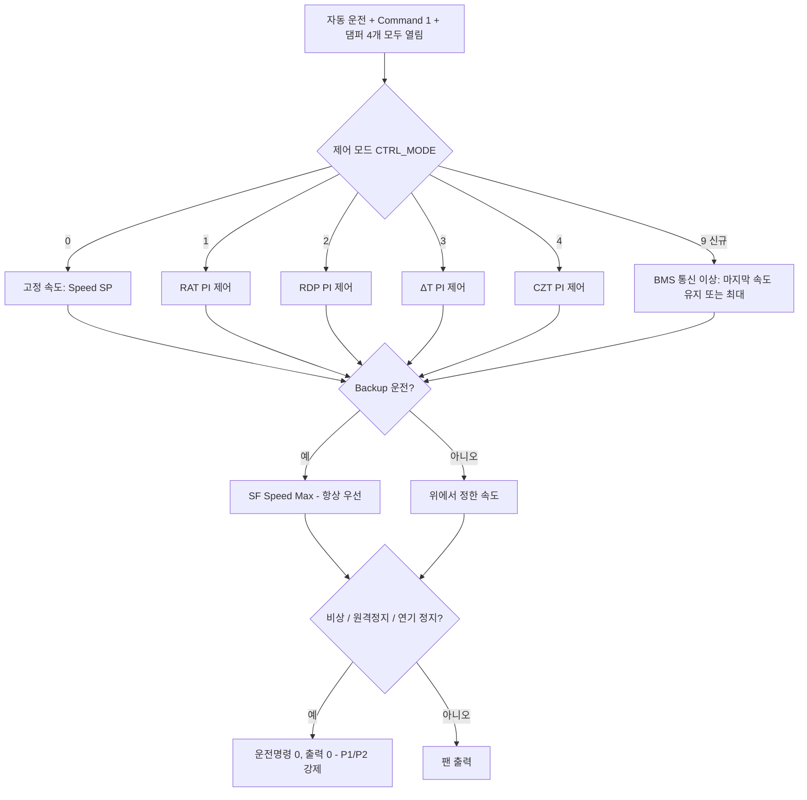

# FWU-F8-ATS 로직 변경 설명서 (rev. 2026-11-10)

> 대상: 처음 이 로직을 보는 사람도 "무엇이 빠졌고, 무엇이 더해졌고, 왜 그런지" 이해할 수 있도록 정리한 문서입니다.
> 근거 문서: [QTS_FWU_Logic_Revision_Review.md](QTS_FWU_Logic_Revision_Review.md) (검토서), QTS RDF `FWU(390 kW)` 시트

---

## 0. 한눈에 보기

| 구분 | 내용 | 한 줄 요약 |
| --- | --- | --- |
| 덜어낸 것 | 중복 계산, 쓰지 않는 값 읽기, 같은 코드 반복 | **동작은 그대로**, 코드만 짧고 읽기 쉽게 |
| 더한 것 | QTS가 요구하는데 없던 기능 4개 | BMS 통신 이상 시 팬 속도, 팬별 고장 알람, 연기 감지 시 계속/정지 선택, ATS·유량계 통신 이상 알람 |
| 보완한 것 | 현재보다 **안전해지는** 방향의 결함 수정 4개 | 비상·원격정지 시 운전명령 0, PICV 피드백 고장 시에도 팬 정지, 센서 고장·잘못된 모드값이면 고정 속도 |
| 그대로 둔 것 | Backup 운전, Failover, 인접 존 보상, ΔT 모드, PICV 제어, 모든 Point | 사용자 요청대로 유지 |
| Point | **삭제 0개 / 이름 변경 0개 / 추가 4개** | "추가는 하되 삭제는 하지 않는다" 원칙 준수 |
| 미뤄둔 것 | BMS Modbus 주소 할당, DDC 로직 실행 순서 | 지금 확정하지 않아도 로직은 동작함 (§7) |

실행 코드 줄 수(주석·빈 줄 제외) 비교:

| 파일 | 변경 전 | 변경 후 | 이유 |
| --- | ---: | ---: | --- |
| [SF Control.py](FWU-F8-ATS/Logic/SF%20Control.py) | 167 | 149 | 반복 제거 > 기능 추가 |
| [Initialization.py](FWU-F8-ATS/Logic/Initialization.py) | 251 | 219 | 팬 상태 판정을 팬당 1줄 조건으로 정리 |
| [Alarm-1.py](FWU-F8-ATS/Logic/Alarm-1.py) | 226 | 251 | 팬별 고장 알람 8개 출력 추가 |
| [Alarm-3.py](FWU-F8-ATS/Logic/Alarm-3.py) | 53 | 65 | ATS·유량계 통신 이상 추가 |
| [Remote Shutdown.py](FWU-F8-ATS/Logic/Remote%20Shutdown.py) | 33 | 44 | 연기 감지 정지 옵션 추가 |
| [Failover.py](FWU-F8-ATS/Logic/Failover.py) | - | - | 주석 1줄만 수정 (로직 변경 없음) |
| [PICV Control.py](FWU-F8-ATS/Logic/PICV%20Control.py), Alarm-2.py | - | - | 변경 없음 |

---

## 1. 먼저 알아두면 좋은 용어

| 용어 | 쉬운 설명 |
| --- | --- |
| Point / VP | DDC 안의 "값 저장 칸". VP(Virtual Point)는 실제 배선 없이 로직이 쓰는 칸 |
| 스캔(scan) | DDC가 로직 파일을 위에서 아래로 한 번 실행하는 것. 계속 반복됨 |
| 우선순위 P1, P2, P5, P11 | 같은 칸에 여러 곳이 값을 쓰면 **숫자가 작은 쪽이 이김**. P1 비상, P2 원격정지, P5 일반 제어, P11 값 보관용 |
| PI 루프 (`LOOP2`) | 측정값이 목표값에 가까워지도록 팬 속도를 자동으로 올리고 내리는 계산기 |
| 루프 초기화 (`LOOP2_INIT`) | 쓰지 않는 계산기를 0으로 리셋. 나중에 다시 쓸 때 엉뚱한 값으로 시작하지 않게 함 |
| 타이머 (`SECTIMER`) | "몇 초 동안 계속되었나"를 세는 초시계. 로직 파일마다 0~9번 10개 |
| BMS PLC Comm Fault | BMS PLC가 주기적으로 바꿔 주는 Heartbeat 값이 30초 동안 안 바뀌면 1이 되는 통신 이상 표시 |

---

## 2. 바뀌지 않은 것 (사용자 결정 사항)

| 항목 | 상태 | 비고 |
| --- | --- | --- |
| Backup 운전 (인접 FWU 고장 시 팬 최대·급기온도 −0.5 ℃) | **유지** | BMS PLC 연동. 새 기능보다 **항상 우선**하도록 맨 마지막에 씀 (답변 1·2) |
| Failover (고장 시 알람 + 자동 정지) | **유지** | 코드 그대로. 주석의 "−1 C" 오기만 실제 값 "−0.5 C"로 수정 |
| 인접 존 보상 (CZT/RDP Comp PV, Adj 값) | **유지** | 현재 로직에 반영된 그대로 (답변 3) |
| ΔT 제어 모드 (SF Control Select = 3) | **유지** | 삭제하지 않음. 센서 고장 때만 고정 속도로 넘어가게 보완 (§5-7) |
| RAT 제어 모드 | **유지** | |
| PICV(냉수 밸브) 제어 | **유지** | 변경 없음 |
| 모든 기존 Point | **유지** | 쓰지 않는 Point도 삭제·이름 변경 없음 |
| BMS Modbus 주소 맵 (ModbusServiceInfo.xml) | **변경 안 함** | 답변 4: 지금 확정 불필요 → 비워 둠 |

---

## 3. 전체 흐름 그림 (SF 속도가 정해지는 순서)

아래 순서대로 위에서부터 판단합니다. **아래쪽에 있는 것이 마지막에 쓰므로 이깁니다.**

---

## 4. 덜어낸 것 (경량화) — 결과는 그대로, 코드만 줄임

> 이 절의 변경은 모두 **팬·밸브가 움직이는 결과가 변경 전과 같습니다.**

### 4-1. ΔT 값을 두 번 계산하던 것 → 한 번만 (SF Control)
- **전**: `Initialization`과 `SF Control`이 같은 `VP_FWU_DeltaT PV = RAT − SAT`를 각각 계산.
- **후**: `Initialization`에서만 계산. `Initialization`이 `SF Control`보다 먼저 실행되므로 같은 스캔 안에서 같은 값을 씀.
- **비유**: 같은 장부를 두 사람이 따로 적던 것을 한 사람만 적게 함.
- ΔT 모드 자체는 **그대로 있습니다.**

### 4-2. 쓰지 않는 HZT 게인 읽기 삭제 (SF Control)
- **전**: `VP_FWU_SF HZT PGain/IGain`을 읽었지만 HZT 제어 모드가 없어 어디에도 쓰이지 않음.
- **후**: 읽는 코드 2줄 삭제. **Point는 그대로 남아 있음.**

### 4-3. 제어 모드를 "한 번에" 결정 (SF Control)
- **전**: `FIXED` 표시(0/1) + 모드마다 `FIXED == 0 and 1 <= SF_SEL < 2` 같은 긴 조건, 모드마다 다른 루프 초기화 3~4줄 반복(총 16줄).
- **후**: 맨 위에서 `CTRL_MODE`(0·1·2·3·4·9) 하나로 결정 → 아래에서는 `if CTRL_MODE == 2 :`처럼 짧게 사용. 쓰지 않는 루프 초기화는 끝에서 4줄로 한 번에 처리.
- **비유**: 갈림길마다 지도를 다시 펴던 것을, 출발 전에 경로를 한 번 정하고 가는 방식으로 바꿈.

### 4-4. 팬 속도 출력 20줄 → 10줄 (SF Control)
- **전**: 통신 정상/이상 두 경우에 각각 10개 출력 칸을 모두 씀 (같은 10줄이 두 번).
- **후**: 경우에 따라 "쓸 값"만 0으로 바꾼 뒤 10줄을 한 번만 씀.
  - 통신 정상: 아날로그 출력 = 0, Modbus RPM = 계산값 (전과 동일)
  - 통신 이상: Modbus RPM = 0, 아날로그 출력 = 계산값 (전과 동일)

### 4-5. 팬 운전명령 16줄 → 8줄 (SF Control)
- **전**: `if 속도 > 0 : 8개 팬에 1 / else : 8개 팬에 0` (16줄).
- **후**: `RUN` 값(0 또는 1)을 먼저 정하고 8줄로 한 번만 씀. (정지 조건 보완은 §5-5)

### 4-6. 팬 운전 상태 판정 48줄 → 16줄 (Initialization)
- **전**: 팬마다 `if 통신이상 : if 차압>10 … else : if RPM>기준 …` 6줄 × 8대.
- **후**: 팬마다 같은 내용을 조건 1개로:
  `(통신이상 그리고 차압 > 10 Pa) 또는 (통신정상 그리고 RPM > 기준)` → 2줄 × 8대.
- 판정 기준·5초 확인 지연은 그대로.

### 4-7. 고장 팬 개수 세기 16줄 → 1줄 (Alarm-1)
- **전**: `if SF1_FAIL : 개수 + 1` 을 8번 반복.
- **후**: 팬별 고장 값을 0/1로 만들고 `SF1_FAIL + … + SF8_FAIL` 한 줄로 합산.
- 이 0/1 값은 그대로 팬별 알람 Point에도 씀 (§5-2).

### 4-8. 검토했지만 하지 않은 경량화
| 항목 | 이유 |
| --- | --- |
| Initialization의 `BMS_OK == 1 and …` 8회 반복 묶기 (검토서 L03) | 묶으면 들여쓰기·줄 수가 오히려 늘어 경량화 효과가 없음 → 그대로 둠 |
| Failover 원래 로직 변경 (검토서 L12) | 사용자 결정으로 철회. 주석 오기만 수정 |

---

## 5. 더한 것 / 보완한 것

### 5-1. [QTS 129~131] BMS 통신 이상 시 팬 속도 선택 — `SF Control`
**QTS 요구**: "BMS와 통신이 끊기면 ① 마지막 팬 속도 유지, ② 최대 팬 속도 중 선택 가능해야 한다."

**새 설정 Point**: `VP_FWU_BMS Comm Fail Mode`
| 값 | 의미 | 동작 |
| --- | --- | --- |
| **0 (기본값)** | 마지막 속도 유지 (HOLD_LAST) | 통신이 끊기기 직전 속도를 그대로 둠. 단, 그 값이 최소 속도보다 낮으면(예: 막 재기동해서 0) 안전하게 최대 속도로 |
| 1 | 최대 속도 (MAX) | `VP_FWU_SF Speed Max`로 운전 |

**언제 적용되나** (모두 만족할 때):
1. `VP_FWU_BMS PLC Comm Fault = 1` (Heartbeat 30초 정지)
2. `REMOTE SELECTION = 1` (원격 모드. 현장(Local) 모드는 운전자가 직접 다루므로 제외)
3. 제어 모드가 **BMS가 보내 주는 값으로 운전하는 모드**일 때: 고정 속도(0), RDP(2), CZT(4)

**적용 안 되는 경우**: RAT(1), ΔT(3) 모드는 FWU 자체 센서로 제어하므로 BMS가 끊겨도 **계속 정상 제어**합니다.

**우선순위**: Backup 운전 > BMS 통신 이상 처리 > 일반 모드 (사용자 답변 2 "현재 코드 방식 유지" 반영)

| 상황 (CZT 모드 예) | 변경 전 | 변경 후 (기본값 0) |
| --- | --- | --- |
| BMS 통신 정상 | CZT PI 제어 | 동일 |
| BMS 통신 끊김 | 고정 속도(Speed SP) | **마지막 속도 유지** (설정 1이면 최대) |
| BMS 끊김 + Backup 지시 | 최대 | 최대 (동일) |

> 참고: `BMS PLC Comm Fault`는 기존 로직대로 **래치**됩니다. 통신이 돌아와도 운전자가 `VP_FWU_BMS PLC Comm Reset`을 눌러야 원래 제어로 돌아갑니다.

### 5-2. [QTS 109] 팬별 고장 알람 — `Alarm-1`
- **전**: 8대 중 4대 이상 고장일 때만 `VP_FWU_SF Failure Alarm` 1개. 어느 팬이 고장인지 알 수 없었음.
- **후**: 이미 있던 Point `VP_FWU_SF-1 ~ SF-8 Run Fail Alarm` 8개에 팬별 결과를 씀.
  - 판정 기준은 기존과 동일: 운전 명령 중 60초 후, 통신 정상이면 RPM < 고장 기준, 통신 이상이면 급기 차압 ≤ 10 Pa
  - 운전 명령이 꺼지면 8개 모두 0으로 리셋
- 4대 이상이면 `SF Failure Alarm` (Failover 원인) — **기존 그대로**.

### 5-3. [QTS 143] 연기 감지 시 "계속 운전 / 정지" 선택 — `Remote Shutdown`
**QTS 요구**: 연기 감지기 동작 시 계속 운전 또는 정지를 현장에서 설정 가능해야 함.

**새 설정 Point**: `VP_FWU_Smoke Action`
| 값 | 의미 |
| --- | --- |
| **0 (기본값)** | 계속 운전 — **변경 전과 같은 동작** |
| 1 | 정지 — 원격 정지(Remote Shutdown)와 **똑같은 경로**로 정지 |

**동작 순서**:
1. 현장 입력 `FWU_FIRE ALARM`(DI)이 3초 계속 ON → 기존 Point `VP_FWU_Fire Alarm` = 1 (알람 표시). OFF가 되면 바로 0.
2. `Smoke Action = 1`이고 `Fire Alarm = 1`이면 → Command 0, PICV 0 %, 팬 출력 0 (P2 강제), 팬이 멈춘 뒤 댐퍼 닫힘.
3. 연기가 해제되면 강제(P2)는 풀리지만 **Command는 0으로 남음** → 운전자가 다시 기동 (원격 정지와 동일).

### 5-4. [QTS 140·148] ATS·유량계 통신 이상 알람 — `Alarm-3`, `Alarm-1`
- **전**: 포트 3의 ATS(전원 절체기), 유량계가 통신이 끊겨도 표시가 없었고, 유량계 값이 멈춘 채로 PICV 알람 판단에 쓰였음.
- **후**:
  - `VP_FWU_ATS Comm Fault` (신규): `FWU-ATS.Current Power` 통신 실패 10초 → 1
  - `VP_FWU_Flow Comm Fault` (신규): `FWU-Flow.Rate` 통신 실패 10초 → 1
  - 유량계 통신 이상 중에는 "밸브 열렸는데 유량 없음 / 닫혔는데 유량 있음" 알람을 **판단하지 않음** (멈춘 값으로 잘못된 알람 방지). 밸브 명령-피드백 불일치(구동기 고장) 알람은 그대로 동작.

### 5-5. 비상·원격정지·연기정지 때 팬 운전명령 0 — `SF Control`
- **전**: 팬 운전명령(`FWU SF-n.Run Command`)은 `SF Speed Value > 0`만 봄. 원격 정지 중에도 BMS가 Command를 더 높은 우선순위로 1로 쓰고 있으면 속도값이 남아 **운전명령이 1로 남을 수 있었음** (출력 RPM은 0으로 강제되지만 "운전 + 0 rpm" 상태).
- **후**: 비상(`FWU_EMERGENCY = 1`), 원격 정지, 연기 정지(§5-3) 중에는 속도값과 관계없이 **운전명령 0**.

### 5-6. 정지할 때 PICV 닫힘 대기 최대 60초 — `SF Control`
- **전**: Command 0 → "PICV 피드백 < 5 %"가 될 때까지 팬을 계속 돌림. **피드백 센서가 고장이면 팬이 영원히 안 멈춤.**
- **후**: 피드백 < 5 % **또는 60초 경과** 시 팬 속도 0. (타이머 2 신규 사용)
- 정상이라면 밸브가 60초 안에 닫히므로 동작은 전과 같습니다.

### 5-7. 센서 고장·잘못된 모드값이면 고정 속도 — `SF Control`
| 상황 | 변경 전 | 변경 후 |
| --- | --- | --- |
| RAT 모드(1)에서 RAT 센서 고장 | 고장 센서 값(약 −20 ℃)으로 PI 제어 → 팬 **최소 속도**까지 떨어짐 | 고정 속도(Speed SP) |
| ΔT 모드(3)에서 RAT 또는 SAT 센서 고장 | 고장 값으로 PI 제어 → 엉뚱한 속도 | 고정 속도(Speed SP) |
| SF Control Select가 0~4 밖의 값(예: 7) | 어떤 모드도 실행 안 됨 → 속도가 **그대로 멈춤** | 고정 속도(Speed SP) |

센서 고장 판정은 기존 알람(`VP_FWU_RAT/SAT Failure Alarm`, 20초 지연)을 그대로 사용합니다. 센서가 복구되면 자동으로 원래 모드로 돌아갑니다.

---

## 6. 새로 추가한 Point (4개)

[VirtualPoint.xml](FWU-F8-ATS/ControlPoint/VirtualPoint.xml) 맨 끝에 추가. 기존 Point 172개 → 176개.

| 이름 | 종류 | 기본값 | 전원 재기동 시 값 유지 | 용도 |
| --- | --- | --- | --- | --- |
| `VP_FWU_BMS Comm Fail Mode` | DV (설정) | 0 | 유지 (backupEnable=1) | §5-1. 0 마지막 속도 유지 / 1 최대 |
| `VP_FWU_Smoke Action` | DV (설정) | 0 | 유지 (backupEnable=1) | §5-3. 0 계속 운전 / 1 정지 |
| `VP_FWU_ATS Comm Fault` | DV (알람) | 0 | - | §5-4 |
| `VP_FWU_Flow Comm Fault` | DV (알람) | 0 | - | §5-4 |

- ID `05000193~05000196`, 주소 `VP05000000AC~AF`: 파일에서 마지막으로 쓰인 번호(로직 ID `10000192`, VP 주소 `…AB`) 다음 번호로 정했습니다. **설정 툴로 불러올 때 번호 충돌이 없는지 한 번 확인**해 주세요.
- 기존에 있었지만 쓰이지 않던 Point 중 이번에 **쓰기 시작한 것**: `VP_FWU_Fire Alarm`, `VP_FWU_SF-1~8 Run Fail Alarm` (이름·설정 변경 없음).
- 기본값(0, 0)이면 연기 감지 동작은 **변경 전과 동일**하고, BMS 통신 이상 시만 "고정 속도 → 마지막 속도 유지"로 바뀝니다.

---

## 7. 지금 확정하지 않고 비워 둔 것

| 항목 | 상태 | 영향 |
| --- | --- | --- |
| BMS Modbus 주소 할당 (신규 4개 Point) | **보류** (답변 4) | 로직은 정상 동작. 단, 할당 전까지 BMS는 이 4개를 읽거나 바꿀 수 없음 → 설정은 HMI/툴에서 변경 |
| DDC.xml 로직 실행 순서 | **변경 안 함** | Alarm-3 결과를 Alarm-1이 다음 스캔에 읽는 정도의 지연(1스캔)만 있음. 동작 문제 없음 |
| BMS PLC Heartbeat 주기 | 미정 | 현재 로직(30초 무변화 = 통신 이상) 그대로 (답변 3) |
| PICV: Command 1인데 팬 상태 0일 때 밸브 0 % (검토서 C04) | **보류** | 팬 상태 판정 오류 시 운전 중 밸브가 닫힐 위험이 있어 "현재보다 위험해지지 않게" 원칙에 따라 적용하지 않음 |
| 2차 하드웨어 항목 (누수·필터·CHWS/R 온도 등, 검토서 H01~H05) | 미구현 | 배선·Point 확정 후 진행 |

---

## 8. 현장 확인 / 시험 체크리스트

| # | 시험 | 기대 결과 |
| --- | --- | --- |
| 1 | CZT 모드 운전 중 BMS PLC Heartbeat 정지 (30초+) | `BMS PLC Comm Fault = 1`, 팬 속도 **직전 값 유지** |
| 2 | 1번 상태에서 `BMS Comm Fail Mode = 1` | 팬 속도 = SF Speed Max |
| 3 | 1번 상태에서 `Backup Operation = 1` | 팬 속도 = SF Speed Max (Backup 우선) |
| 4 | RAT 모드에서 BMS 통신 끊김 | RAT PI 제어 계속 (변화 없음) |
| 5 | Local 모드에서 BMS 통신 끊김 | 기존과 같이 고정 속도(Speed SP) |
| 6 | 팬 1대 RPM 강제 저하 (운전 60초 후) | 해당 `SF-n Run Fail Alarm = 1`, `SF Failure Alarm = 0` |
| 7 | 팬 4대 고장 | `SF Failure Alarm = 1` → Failover (기존과 동일) |
| 8 | `FWU_FIRE ALARM` ON, `Smoke Action = 0` | `Fire Alarm = 1`, **운전 계속** |
| 9 | `FWU_FIRE ALARM` ON, `Smoke Action = 1` | 원격 정지와 같이 정지, 해제 후 Command 0 유지 |
| 10 | ATS / 유량계 통신선 분리 (10초+) | `ATS Comm Fault` / `Flow Comm Fault = 1`, 유량 기반 PICV 알람 미발생 |
| 11 | 원격 정지 중 BMS가 Command 1 유지 | 팬 Run Command = 0 |
| 12 | 운전 중 PICV 피드백 선 분리 후 Command 0 | 60초 후 팬 정지 |
| 13 | RAT 모드에서 RAT 센서 분리 (20초+) | 고정 속도(Speed SP)로 전환, 복구 시 RAT 제어 복귀 |
| 14 | SF Control Select = 7 입력 | 고정 속도(Speed SP) |
| 15 | ΔT 모드 정상 운전 | 기존과 동일하게 ΔT PI 제어 |

확인 필요:
- `FWU_FIRE ALARM` 입력 극성 (1 = 연기 감지로 가정).
- `Smoke Action = 1`, `Group Control Mode = 1`일 때 연기 정지로 Command가 0이 되면 Failover 원인 4(그룹 제어 중 정지)가 발생할 수 있음. Failover 코드는 요청대로 바꾸지 않았으므로 현장 정책 확인 필요.

---

## 9. 파일별 변경 위치 요약

| 파일 | 변경 내용 |
| --- | --- |
| [SF Control.py](FWU-F8-ATS/Logic/SF%20Control.py) | §4-1·4-2·4-3·4-4·4-5, §5-1·5-5·5-6·5-7. 타이머 2 신규 |
| [Initialization.py](FWU-F8-ATS/Logic/Initialization.py) | §4-6, ΔT 주석 정리 |
| [Alarm-1.py](FWU-F8-ATS/Logic/Alarm-1.py) | §4-7, §5-2, §5-4(유량 알람 억제) |
| [Alarm-3.py](FWU-F8-ATS/Logic/Alarm-3.py) | §5-4. 타이머 8·9 신규 |
| [Remote Shutdown.py](FWU-F8-ATS/Logic/Remote%20Shutdown.py) | §5-3. 타이머 0 신규 |
| [Failover.py](FWU-F8-ATS/Logic/Failover.py) | 주석 1줄 (−1 C → −0.5 C) |
| [VirtualPoint.xml](FWU-F8-ATS/ControlPoint/VirtualPoint.xml) | Point 4개 추가 (§6) |

각 로직 파일 상단 주석에 `rev. 2026-11-10` 변경 이력과 사용 타이머 목록을 갱신했습니다.
