# FWU-F8-ATS 로직 초보자 설명서

> 대상: DDC 로직을 처음 보는 사람
> 기준 코드: `sy` 브랜치 `FWU-F8-ATS/Logic/*.py` 8개 ("logic code 수정 2" 이후)
> 줄 번호는 이 기준 코드의 줄 번호입니다. 코드가 바뀌면 번호도 바뀔 수 있습니다.

---

## 0. 이 문서 읽는 법

1. **1장**에서 용어 6개(관제점, 스캔, 우선순위, 타이머, PI 루프, 루프 초기화)를 먼저 익힙니다.
2. **2장** 그림으로 장비가 어떻게 연결되는지, **3장**에서 8개 파일이 어떤 순서로 도는지 봅니다.
3. **4장**에서 FWU가 켜지고 꺼지는 과정을 흐름도로 봅니다.
4. **5장부터** 파일별로 "역할 한 줄 → 흐름도 → 줄별 해석" 순서로 읽습니다.
   - 같은 모양이 팬 8대만큼 반복되는 부분은 **첫 번째만 줄별로 설명**하고 나머지는 "같음"으로 묶었습니다.
   - `#`로 시작하는 줄은 주석(사람이 읽는 메모)이라 해석에서 뺐습니다.

---

## 1. 먼저 알아야 할 개념

| 용어 | 쉬운 설명 | 코드에서 |
| --- | --- | --- |
| DDC | 공조기를 제어하는 작은 컴퓨터. 센서를 읽고 팬·밸브·댐퍼에 명령을 보냄 | - |
| 관제점 (Point) | DDC 안의 "값 저장 칸". 이름으로 찾음 | `"FWU_SAT"`, `"VP_FWU_Command"` |
| IO 점 | 실제 전선으로 연결된 센서·출력. AI(아날로그 입력), DI(접점 입력), AO(아날로그 출력), DO(접점 출력) | `FWU_SAT`(AI), `FWU_FIRE ALARM`(DI) |
| Modbus 점 | 통신선으로 연결된 장치(EC 팬, ATS, 유량계)의 값 | `FWU SF-1.Current RPM` |
| VP (가상 점) | 전선 없이 로직·BMS·HMI가 쓰는 값 저장 칸. 설정값, 계산값, 알람 | `VP_FWU_SF Speed Value` |
| 스캔 (Scan) | DDC가 로직 파일 8개를 위에서 아래로 한 번씩 실행하는 것. 계속 반복됨 | - |
| `READPOINT("이름")` | 관제점 값을 읽음 | |
| `WRITEPOINT("이름", 값)` | 관제점에 값을 씀 (우선순위 5) | |
| 우선순위 (Priority) | 한 관제점에 여러 곳이 값을 쓰면 **숫자가 작은 쪽이 이김** (1~16) | `WRITEPOINT_PRI("이름", 값, 2)` |
| `RELEASE_PRI("이름", n)` | n번 우선순위에 쓴 값을 지움 → 그다음 우선순위 값이 적용됨 | |
| `SECTIMER(n, 1)` | n번 초시계의 현재 시간(초)을 읽음. 파일마다 0~9번 10개 | |
| `SECTIMER(n, 0)` | n번 초시계를 0으로 리셋 | |
| PI 루프 `LOOP2(...)` | 측정값(PV)이 목표값(SP)에 가까워지도록 출력을 자동으로 올리고 내림 | |
| `LOOP2_INIT(n)` | n번 PI 루프의 누적값을 지움. 안 쓰는 루프는 매번 초기화 | |
| `READPOINT_ALARM("이름")` | 관제점의 알람 상태를 읽음. 8 = 통신 경보 | |
| `MAX(a, b, …)` / `MIN(…)` | 가장 큰 값 / 가장 작은 값 (최대 5개) | |

### 1.1 우선순위 쉽게 이해하기

한 관제점에는 1번부터 16번까지 "칸"이 있고, 값이 들어 있는 칸 중 **번호가 가장 작은 칸의 값**이 실제 값이 됩니다.

| 칸 | 이 코드에서 누가 쓰나 | 의미 |
| --- | --- | --- |
| P1 | 비상 정지 (SF Control, PICV Control) | 무조건 정지. 가장 강함 |
| P2 | 원격 정지·연기 정지 (Remote Shutdown) | 정지 강제 |
| P5 | 일반 제어 (`WRITEPOINT`) | 평소 자동 제어 값 |
| P11 | 값 보관용 | 자동 → 수동으로 바꿔도 값이 유지되게 복사해 두는 칸. 운전명령도 여기에 씀 |

예: 평소 팬 RPM은 P5에 1200이 들어 있습니다. 원격 정지가 걸리면 P2에 0을 씁니다 → P2가 이기므로 팬은 0. 원격 정지가 풀리면 `RELEASE_PRI(…, 2)`로 P2를 지움 → 다시 P5의 값이 적용됩니다.

### 1.2 타이머 패턴 (이 코드에서 계속 나옴)

```python
if 조건 :                          # 조건이 맞는 동안
	if engine.SECTIMER(0, 1) > 20 :  # 20초가 넘으면
		engine.WRITEPOINT("알람", 1)   # 알람 ON
else :                             # 조건이 안 맞으면
	engine.SECTIMER(0, 0)            # 초시계 리셋
	engine.WRITEPOINT("알람", 0)     # 알람 OFF
```

"조건이 **20초 계속** 유지되면 알람"이라는 뜻입니다. 잠깐 튀는 신호로 알람이 나지 않게 합니다.

### 1.3 PI 루프 방향 (type)

| type | 의미 | 이 코드에서 |
| --- | --- | --- |
| 1 | PV가 SP보다 **높으면** 출력을 올림 | 냉수밸브(급기온도), RAT·CZT·ΔT 팬 제어 |
| 0 | PV가 SP보다 **낮으면** 출력을 올림 | RDP(실 차압) 팬 제어 |

---

## 2. 장비 구성

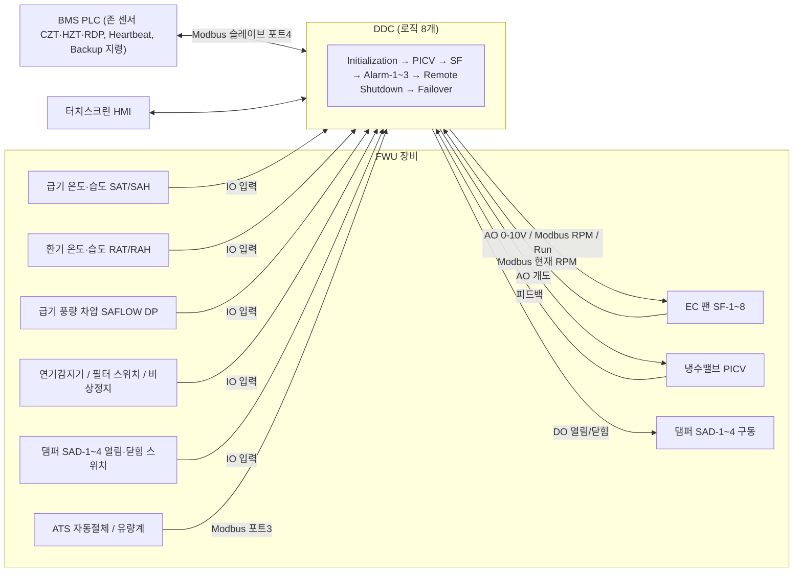

| 장치 | 연결 | 관제점 예 |
| --- | --- | --- |
| 급기·환기 온습도, 급기 차압 | UI14 모듈 아날로그 입력 | `FWU_SAT`, `FWU_RAT`, `FWU_SAFLOW DP` |
| 비상정지, 연기감지, 필터, 댐퍼 스위치 | UI14·CM 모듈 접점 입력 | `FWU_EMERGENCY`, `FWU_FIRE ALARM` |
| EC 팬 8대 | Modbus 포트1(SF-1~4), 포트2(SF-5~8) + 비상용 AO 2개 | `FWU SF-1.Target RPM Set`, `FWU_SF-1_4 SPEED CONTROL` |
| 냉수밸브 PICV | CM 모듈 AO3, 피드백 UI7 | `FWU_PICV CONTROL`, `FWU_PICV FEEDBACK` |
| 댐퍼 4개 | CM 모듈 DO9 (4개 공통) | `FWU_SAD-1_4 COMMAND` |
| ATS, 유량계 | Modbus 포트3 | `FWU-ATS.*`, `FWU-Flow.Rate` |
| 존 온도·차압 | BMS PLC가 VP에 써 줌 | `VP_FWU_CZT-1~4`, `VP_FWU_RDP-1~2` |

---

## 3. 한 스캔에서 8개 파일이 도는 순서

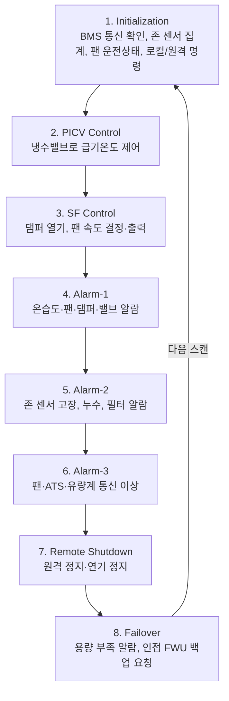

- 앞 파일이 쓴 값은 **같은 스캔**에서 뒤 파일이 바로 읽습니다.
- 뒤 파일이 쓴 값(예: Alarm-3의 통신 이상)은 앞 파일이 **다음 스캔**에 읽습니다.

---

## 4. FWU 운전 전체 흐름 (자동 모드)

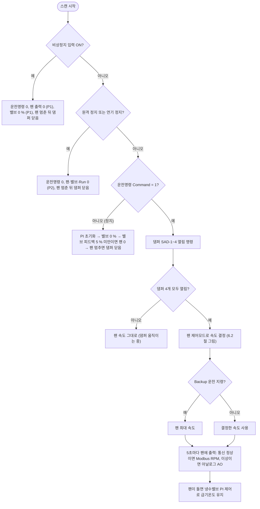

---

## 5. Initialization.py — 측정값 정리와 기본 상태 판단

**역할 한 줄:** BMS 통신 상태를 확인하고, 존 센서값을 평균·최대·최소로 정리하고, 팬이 돌고 있는지 판단하고, 로컬/원격 운전명령을 맞춥니다.

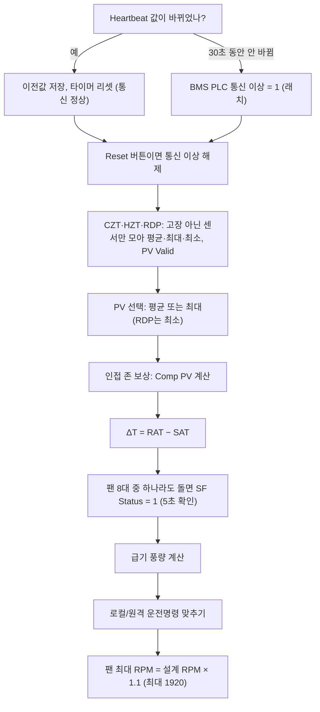

| 줄 | 코드 (요약) | 해석 |
| --- | --- | --- |
| 1 | `engine = ddc_logic()` | 모든 로직 첫 줄. DDC 기능을 쓰는 `engine` 준비 |
| 49 | `HB = READPOINT("VP_FWU_BMS PLC Heartbeat")` | BMS PLC가 계속 바꿔 주는 하트비트 값을 읽음 |
| 50 | `if HB != … Heartbeat Prev :` | 지난번 저장한 값과 다르면 = BMS가 살아 있음 |
| 51 | `WRITEPOINT("… Heartbeat Prev", HB)` | 이번 값을 저장해 다음 스캔에 비교 |
| 52 | `SECTIMER(6, 0)` | 6번 타이머 리셋 (무변화 시간 다시 셈) |
| 53 | `HB_OK = 1` | 통신 정상 표시 (이번 스캔 안에서만 쓰는 변수) |
| 54~55 | `else : if SECTIMER(6, 1) > 30 :` | 값이 안 바뀐 채 30초가 넘으면 |
| 56~57 | `HB_OK = 0`, `WRITEPOINT("… Comm Fault", 1)` | 통신 이상으로 판정하고 알람 1. 다시 0으로 돌리는 코드가 여기엔 없으므로 **래치**됨 |
| 58~59 | `else : HB_OK = 1` | 30초가 안 됐으면 아직 정상 |
| 62 | `if … Comm Reset == 1 :` | 운전자가 Reset 버튼을 누르면 |
| 63~64 | `if HB_OK == 1 : WRITEPOINT("… Comm Fault", 0)` | 하트비트가 살아 있을 때만 통신 이상 해제 |
| 65~67 | `if SECTIMER(7, 1) > 5 : WRITEPOINT_PRI("… Comm Reset", 0, 11)` | Reset을 5초 유지(HMI 확인용) 후 0으로 되돌림 |
| 68~69 | `else : SECTIMER(7, 0)` | Reset이 아니면 7번 타이머 리셋 |
| 71~74 | `if … Comm Fault == 1 : BMS_OK = 0 else 1` | 통신 이상이면 BMS가 준 존 센서값을 쓰지 않기 위한 표시 |
| 77~80 | `czt1 = READPOINT("VP_FWU_CZT-1")` … `czt4` | 냉복도 온도센서 4개 값 읽기 (BMS PLC가 써 줌) |
| 84~87 | `CZT_CNT = 0`, `CZT_SUM = 0`, `CZT_MAXV = -1000`, `CZT_MINV = 1000` | 개수·합계·최대·최소 계산용 시작값 |
| 88 | `if BMS_OK == 1 and … CZT-1 Failure Alarm == 0 :` | 통신 정상이고 1번 센서가 고장이 아니면 (고장 판정은 Alarm-2) |
| 89~92 | `CZT_CNT + 1`, `CZT_SUM + czt1`, `MAX`, `MIN` | 1번 센서를 집계에 포함 |
| 93~107 | (CZT-2~4 같은 모양) | 2~4번 센서도 같은 방법으로 집계 |
| 108~112 | `if CZT_CNT > 0 :` → Avg, Max, Min, `PV Valid = 1` | 정상 센서가 1개라도 있으면 평균(합계÷개수)·최대·최소를 쓰고 "유효" 표시 |
| 113~117 | `else :` → 모두 0, `PV Valid = 0` | 정상 센서가 하나도 없으면 0과 "무효" 표시 |
| 120~148 | (HZT-1~2 같은 모양) | 열복도 온도 2개도 같은 방법 |
| 151~179 | (RDP-1~2 같은 모양) | 실 차압 2개도 같은 방법 |
| 182~185 | `czh1 = READPOINT("VP_FWU_CZH-1")` … | 냉복도 습도 4개 읽기 |
| 186~188 | `CZH Avg / Max / Min` | 습도는 고장 판정 없이 4개 그대로 평균·최대·최소 (표시용) |
| 196 | `if … CZT PV Valid == 1 :` | CZT 값이 유효하면 |
| 197~200 | `if CZT Select == 0 : PV = Avg else : PV = Max` | 선택 0이면 평균, 1이면 최대값을 제어값(PV)으로 |
| 201~202 | `else : CZT PV = 0` | 무효면 0 |
| 204~210 | (HZT 같은 모양) | HZT도 평균 또는 최대 |
| 212~218 | (RDP: 0 = Avg, 1 = **Min**) | 차압은 낮은 쪽이 위험하므로 선택 1이면 최소값 |
| 234 | `COMP_W = MIN(MAX(Adj Comp Weight / 100, 0), 1)` | 인접 존 보상 비율(%)을 0~1 사이 숫자로 (70 % → 0.7) |
| 237~239 | `CZT_OWN = CZT PV`, `CZT_SP = CZT SP`, `CZT_COMP = CZT_OWN` | 자기 존 값과 목표값. 기본은 보상 없이 자기 값 |
| 240 | `if CZT PV Valid == 1 and COMP_W > 0 :` | 자기 값이 유효하고 보상을 쓸 때만 |
| 241 | `CZT_NB = -1000` | 인접 존 최대값 찾기 시작값 |
| 242~249 | `if CZT Adj-n >= 0 : CZT_NB = MAX(…)` | 인접 존 온도 4개 중 정상 범위(0 이상)인 값의 최대 |
| 250 | `if CZT_NB > CZT_SP and CZT_OWN >= CZT_SP - Own Margin :` | 인접 존이 목표보다 덥고, 자기 존이 너무 차갑지 않으면 |
| 251 | `CZT_COMP = MAX(CZT_OWN, CZT_SP + COMP_W × (CZT_NB − CZT_SP))` | 인접 존의 초과분에 가중치를 곱해 더한 값과 자기 값 중 **더 나쁜(높은) 값** |
| 252 | `WRITEPOINT("VP_FWU_CZT Comp PV", CZT_COMP)` | CZT 제어모드가 실제로 쓰는 값 |
| 255~266 | (RDP 같은 모양, 방향 반대) | 차압은 인접 존이 목표보다 **낮으면** 보상, **더 낮은 값** 사용 |
| 269 | `DeltaT PV = FWU_RAT - FWU_SAT` | 환기온도 − 급기온도 = 공기 온도차(ΔT) |
| 274~281 | `SF1_CF = READPOINT("VP_FWU_SF-1 Comm Fault")` … | 팬 8대 통신 이상 상태 읽기 (판정은 Alarm-3) |
| 288~290 | `FAIL_RPM = … Failure RPM Set`, `SAFLOW_DP = …`, `SF_RUN = 0` | 팬 운전 판단 기준 RPM(기본 150), 급기 차압, "운전 중" 표시 시작값 0 |
| 293~295 | `if SF1_CF == 1 : if SAFLOW_DP > 10 : SF_RUN = 1` | 1번 팬 통신 이상이면 RPM을 못 읽으니 급기 차압이 10 Pa 넘으면 돈다고 봄 |
| 296~298 | `else : if SF-1 RPM > FAIL_RPM : SF_RUN = 1` | 통신 정상이면 RPM이 기준보다 높으면 돈다고 봄 |
| 301~354 | (SF-2~8 같은 모양) | 8대 중 하나라도 돌면 `SF_RUN = 1` |
| 358~361 | `if SF_RUN != SF Status : if SECTIMER(5, 1) > 5 : WRITEPOINT("SF Status", SF_RUN)` | 새 상태가 5초 계속돼야 SF Status를 바꿈 (깜빡임 방지) |
| 362~363 | `else : SECTIMER(5, 0)` | 상태가 같으면 타이머 리셋 |
| 369~371 | `if SF Status == 1 and DP >= 5 : saflow = 235.75 × √DP × SAF VA-2` | 팬이 돌고 차압이 5 Pa 이상이면 풍량(CMH) 계산 |
| 372~373 | `else : SA Flow = 0` | 아니면 0 |
| 380 | `if REMOTE SELECTION == 1 :` | 현장 선택 스위치가 원격(Remote)이면 |
| 381 | `RELEASE_PRI("VP_FWU_Command", 5)` | BMS 운전명령을 덮지 않도록 P5 해제 |
| 382~383 | `Command-HMI = Command` (P5, P11) | BMS 명령을 터치스크린 명령에 복사 (화면 표시 일치) |
| 384~387 | `else :` 반대로 `Command = Command-HMI` | 로컬이면 터치스크린 명령을 운전명령에 복사 |
| 390 | `SF Max RPM = MIN(Design RPM × 1.1, 1920)` | 팬 최대 RPM = 설계 RPM의 110 %, 단 1920 rpm을 넘지 않음 |

---

## 6. SF Control.py — 팬과 댐퍼 제어

**역할 한 줄:** 운전명령이 오면 댐퍼를 열고, 댐퍼가 다 열리면 선택한 제어모드로 팬 속도를 정해 5초마다 팬에 보냅니다.

### 6.1 전체 흐름

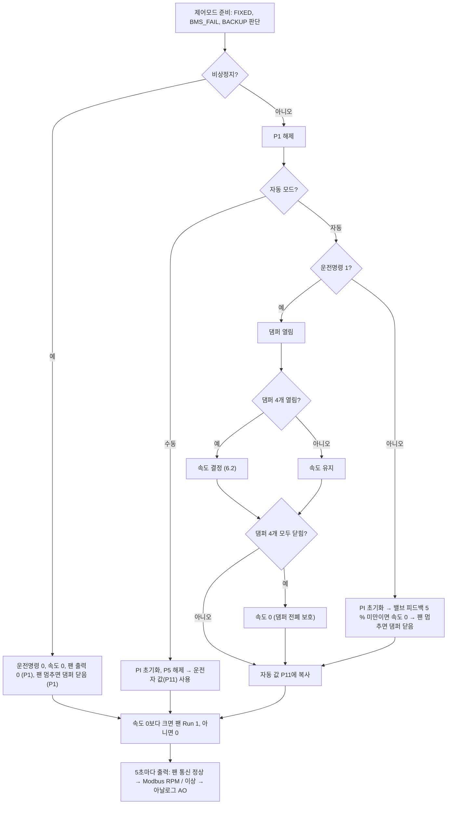

### 6.2 팬 속도 결정 (댐퍼 4개가 모두 열린 뒤)

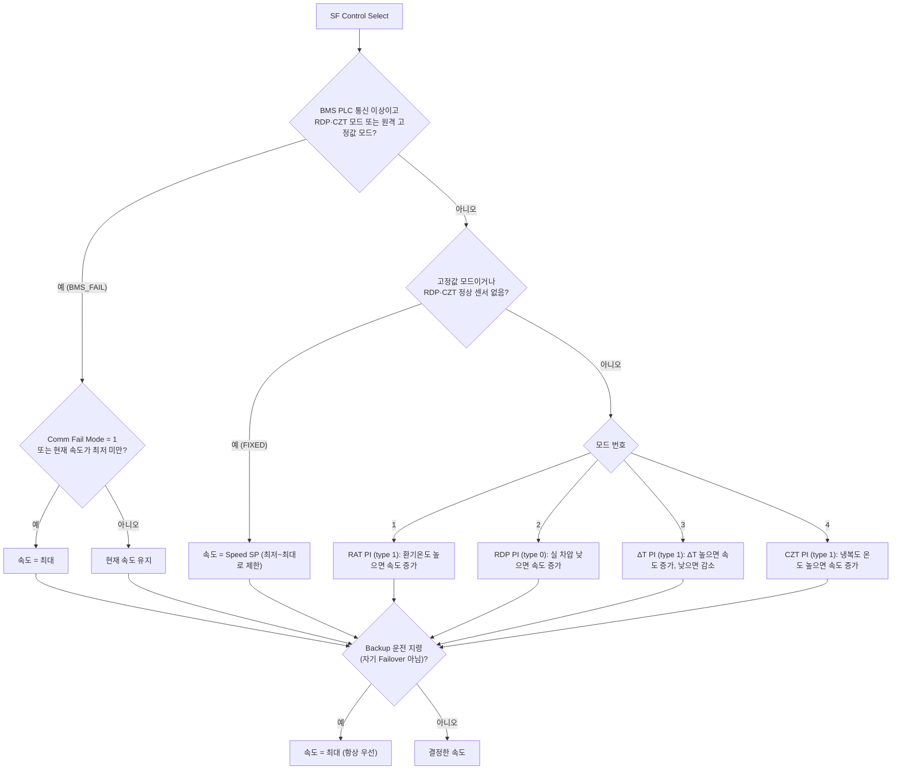

### 6.3 줄별 해석

| 줄 | 코드 (요약) | 해석 |
| --- | --- | --- |
| 1 | `engine = ddc_logic()` | 시작 |
| 72 | `SF_SEL = READPOINT("VP_FWU_SF Control Select")` | 팬 제어모드 번호 (0 고정값, 1 RAT, 2 RDP, 3 ΔT, 4 CZT) |
| 73 | `FIXED = 0` | 고정값 제어 여부 시작값 |
| 74~75 | `if 0 <= SF_SEL < 1 : FIXED = 1` | 모드 0이면 고정값 |
| 76~77 | `if 2 <= SF_SEL < 3 and RDP PV Valid != 1 : FIXED = 1` | RDP 모드인데 정상 차압센서가 없으면 고정값으로 |
| 78~79 | `if 4 <= SF_SEL < 5 and CZT PV Valid != 1 : FIXED = 1` | CZT 모드인데 정상 온도센서가 없으면 고정값으로 |
| 87 | `BMS_FAIL = 0` | BMS 통신 이상 대응 여부 시작값 |
| 88 | `if BMS PLC Comm Fault == 1 :` | BMS PLC 통신 이상이면 (QTS 129~131) |
| 89~90 | `if 2 <= SF_SEL < 3 or 4 <= SF_SEL < 5 : BMS_FAIL = 1` | RDP·CZT 모드는 BMS가 주는 존 센서를 쓰므로 대응 대상 |
| 91~92 | `if 0 <= SF_SEL < 1 and REMOTE SELECTION == 1 : BMS_FAIL = 1` | 원격 모드의 고정값은 BMS가 쓰는 Speed SP라서 대응 대상 (로컬은 터치스크린 값이라 제외) |
| 93~94 | `if BMS_FAIL == 1 : FIXED = 0` | BMS 이상 대응이 고정값 대신 적용됨 |
| 97 | `DeltaT PV = RAT - SAT` | ΔT 계산 (Initialization과 같은 값) |
| 100~109 | `SA_HZT_P = …` … `SA_CZT_I = …` | 모드별 PI 게인 읽기 (HZT 게인은 읽기만 하고 쓰지 않음) |
| 112~115 | `if Backup Operation == 1 and Failover Alarm == 0 : BACKUP = 1` | BMS가 백업 운전을 지시했고 자기 FWU가 고장이 아니면 백업 |
| 118 | `if FWU_EMERGENCY == 0 :` | 비상정지가 아니면 (평상시) |
| 120~130 | `RELEASE_PRI(…, 1)` 11줄 | 비상 때 P1에 넣었던 0을 지움 (팬 AO 2, 팬 RPM 8, 댐퍼 1) |
| 132 | `if Operation Mode == 1 :` | 자동 모드이면 |
| 133 | `if VP_FWU_Command == 1 :` | 운전명령 ON이면 |
| 135 | `WRITEPOINT("FWU_SAD-1_4 COMMAND", 1)` | 댐퍼 4개 열림 명령 |
| 137 | `if SAD-1~4 OPEN STATUS 모두 1 :` | 4개가 모두 열린 게 확인되면 팬 제어 시작 |
| 142~145 | `if FIXED == 1 :` → `speed = MIN(MAX(Speed SP, Speed Min), Speed Max)` | 고정값 모드: Speed SP를 최저~최대 사이로 제한해 속도로 씀 |
| 146~149 | `LOOP2_INIT(1~4)` | PI 루프 4개 모두 초기화 (안 쓰므로) |
| 151~152 | `if FIXED == 0 and 1 <= SF_SEL < 2 : LOOP2(1, "FWU_RAT", …, 1, 0)` | RAT 모드: 환기온도를 RAT SP로 맞추는 PI. type 1 = 높으면 속도 증가. 시작값 60 %, 출력 범위 최저~최대, 루프 1번 |
| 153~155 | `LOOP2_INIT(2, 3, 4)` | 다른 루프 초기화 |
| 158~159 | `if FIXED == 0 and BMS_FAIL == 0 and 2 <= SF_SEL < 3 : LOOP2(0, "VP_FWU_RDP Comp PV", …, 2, 0)` | RDP 모드: 실 차압(보상값)을 RDP SP로. type 0 = 낮으면 속도 증가. 루프 2번 |
| 166~167 | `if FIXED == 0 and 3 <= SF_SEL < 4 : LOOP2(1, "VP_FWU_DeltaT PV", …, 3, 0)` | ΔT 모드: type 1. ΔT가 SP보다 크면 속도 증가(풍량↑ → ΔT↓), 작으면 감소. 루프 3번 |
| 173~174 | `if FIXED == 0 and BMS_FAIL == 0 and 4 <= SF_SEL < 5 : LOOP2(1, "VP_FWU_CZT Comp PV", …, 4, 0)` | CZT 모드: 냉복도 온도(보상값)를 CZT SP로. type 1. 루프 4번 |
| 185 | `if BMS_FAIL == 1 :` | BMS 통신 이상 대응 |
| 186~187 | `if Comm Fail Mode == 1 or Speed Value < Speed Min : Speed Value = Speed Max` | 설정 1이면 최대. 설정 0이어도 지금 속도가 없으면(최저 미만, 예: 막 기동) 최대. 그 외에는 아무것도 안 써서 **마지막 속도 유지** |
| 188~191 | `LOOP2_INIT(1~4)` | PI 멈춤 → 초기화 |
| 194~199 | `if BACKUP == 1 : Speed Value = Speed Max`, `LOOP2_INIT(1~4)` | 백업 운전이면 어떤 모드든 최대 속도. 맨 마지막에 써서 항상 우선 |
| 203~208 | `if SAD-1~4 CLOSE STATUS 모두 1 :` → `LOOP2_INIT`, `Speed Value = 0` | 운전 중 댐퍼 4개가 모두 닫혀 있으면 바람길이 막힌 것 → 팬 정지 |
| 211 | `else:` | 운전명령 OFF이면 |
| 213~216 | `LOOP2_INIT(1~4)` | PI 초기화 |
| 218~219 | `if PICV FEEDBACK < 5 : Speed Value = 0` | 냉수밸브가 거의 닫힌 뒤에 팬 정지 (결로 방지 순서) |
| 221~222 | `if SF Status == 0 : SAD COMMAND = 0` | 팬이 멈춘 걸 확인한 뒤 댐퍼 닫음 |
| 224~225 | `WRITEPOINT_PRI(Speed Value, …, 11)`, `WRITEPOINT_PRI(SAD COMMAND, …, 11)` | 자동 값을 P11에 복사 → 수동으로 바꿔도 그 값에서 시작 |
| 227~233 | `else:` (수동) → `LOOP2_INIT(1~4)`, `RELEASE_PRI(Speed Value, 5)`, `RELEASE_PRI(SAD COMMAND, 5)` | 수동 모드: 자동 제어 값(P5)을 지워 운전자 값이 적용되게 함 |
| 234 | `else:` | 비상정지이면 |
| 236~237 | `Command / Command-HMI = 0 (P11)` | 운전명령 끔 (해제 후 자동 재기동 방지) |
| 238~243 | `LOOP2_INIT(1~4)`, `Speed Value = 0` (P5, P11) | PI 초기화, 속도 0 |
| 245~248 | `if SF Status == 0 : SAD COMMAND = 0 (P5, P11, P1)` | 팬이 멈춘 뒤 댐퍼 닫음 (P1로 강제) |
| 250~259 | `WRITEPOINT_PRI(…SPEED CONTROL / Target RPM Set, 0, 1)` 10줄 | 팬 아날로그 출력 2개, 팬 RPM 8개를 P1로 0 강제 |
| 264~272 | `if Speed Value > 0 : SF-1~8 Run Command = 1` | 속도가 있으면 팬 8대 운전 지령 ON |
| 273~281 | `else : Run Command = 0` | 속도가 0이면 OFF (원격·연기 정지 중에는 Remote Shutdown이 P2로 0 강제) |
| 292 | `if SECTIMER(1, 1) > 5 :` | 5초마다 한 번 팬에 속도를 보냄 (통신량 줄이기) |
| 293~294 | `SF_SPEED = Speed Value`, `SF_MAXRPM = SF Max RPM` | 현재 속도(%)와 최대 RPM |
| 295 | `sfrpmset = MIN(SF_SPEED × SF_MAXRPM / 100, SF_MAXRPM)` | Modbus로 보낼 목표 RPM (% → rpm) |
| 296 | `sfaoset = SF_SPEED × SF_MAXRPM / 1920` | 아날로그 출력값 (1920 rpm 기준 0~100 %) |
| 298~309 | `if SF Comm Fault == 1 :` → AO = sfaoset, Target RPM = 0 | 팬 하나라도 통신 이상이면 아날로그 출력으로 운전 |
| 310~321 | `else :` → AO = 0, Target RPM = sfrpmset | 통신 정상이면 Modbus 목표 RPM으로 운전 |
| 323 | `SECTIMER(1, 0)` | 5초 타이머 다시 시작 |

---

## 7. PICV Control.py — 냉수밸브 제어

**역할 한 줄:** 팬이 도는 동안 냉수밸브(PICV) 개도를 PI로 조절해 급기온도(SAT)를 설정값으로 유지합니다.

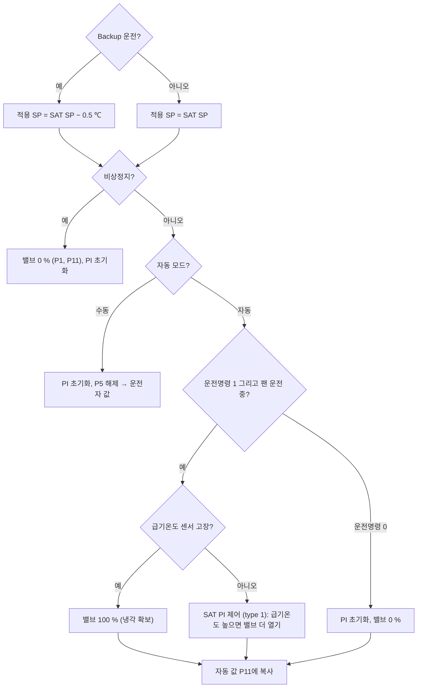

| 줄 | 코드 (요약) | 해석 |
| --- | --- | --- |
| 31~32 | `PICV_P = …PGain`, `PICV_I = …IGain` | PI 게인 |
| 35~36 | `if Backup Operation == 1 and Failover Alarm == 0 : SAT SP Active = SAT SP - 0.5` | 백업 운전 중에는 급기온도를 0.5 ℃ 더 낮게 → 냉방 더 함 |
| 37~38 | `else : SAT SP Active = SAT SP` | 평상시 설정값 그대로 |
| 41 | `if FWU_EMERGENCY == 0 :` | 비상정지가 아니면 |
| 43 | `RELEASE_PRI("FWU_PICV CONTROL", 1)` | 비상 때 넣은 P1 해제 |
| 45 | `if Operation Mode == 1:` | 자동 모드 |
| 46 | `if Command == 1 and SF Status == 1 :` | 운전 중이고 팬이 돌 때만 밸브 제어 (바람 없이 냉수만 흐르지 않게) |
| 48~49 | `if SAT Failure Alarm == 1 : PICV = 100` | 급기온도 센서 고장이면 밸브 활짝 (과열 방지) |
| 51~52 | `else : LOOP2(1, "FWU_SAT", "FWU_PICV CONTROL", "… SAT SP Active", P, I, 0, 1, 100, MinSP, 100, 1, 0)` | 급기온도 PI. type 1, 샘플링 1초, 시작 100 %, 범위 MinSP~100 %, 루프 1번 |
| 53~56 | `if Command == 0 : LOOP2_INIT(1)`, `PICV = 0` | 운전명령 OFF면 PI 초기화 후 밸브 닫음 |
| 58 | `WRITEPOINT_PRI("FWU_PICV CONTROL", 현재값, 11)` | 자동 값을 P11에 복사 |
| 60~62 | `else:` (수동) → `LOOP2_INIT(1)`, `RELEASE_PRI(…, 5)` | 수동: 자동 값 지움 → 운전자 값 |
| 63~68 | `else:` (비상) → `LOOP2_INIT(1)`, `PICV = 0 (P1, P11)` | 비상: 밸브 0 % 강제, P11도 0이라 비상 해제 후 저절로 다시 열리지 않음 |

---

## 8. Alarm-1.py — 온습도·팬·댐퍼·밸브 알람

**역할 한 줄:** 온습도·차압 상하한, 팬 고장, 센서 고장, 댐퍼 이상, 냉수밸브 이상을 판정해 알람 관제점에 씁니다. (타이머 0~9 모두 사용)

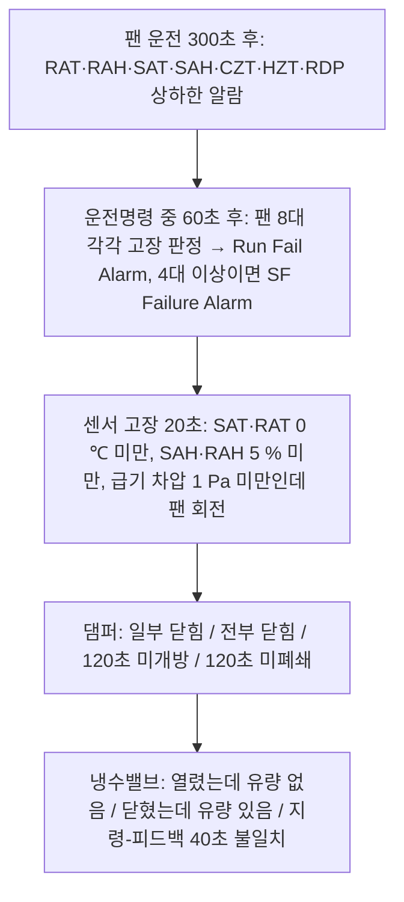

| 줄 | 코드 (요약) | 해석 |
| --- | --- | --- |
| 56 | `if SF Status == 1 and SECTIMER(0, 1) > 300 :` | 팬이 돈 지 300초(5분) 지난 뒤부터 상하한 판정 (기동 직후 오경보 방지) |
| 58~59 | `if RAT > RAT High Alarm SP : RAT High Alarm = 1` | 환기온도가 상한보다 높으면 알람 |
| 60~61 | `if RAT < High SP - 0.5 : … = 0` | 상한보다 0.5 ℃ 이상 내려가야 해제 (히스테리시스, 깜빡임 방지) |
| 63~66 | (Low 같은 모양) | 하한 알람과 해제 |
| 68~99 | (RAH, SAT, SAH 같은 모양) | 습도는 히스테리시스 5 % |
| 102~112 | `if CZT PV Valid == 1 :` → `CZT Max`로 상한, `CZT Min`로 하한. 무효면 0 | 냉복도 온도: 가장 높은 센서로 상한, 가장 낮은 센서로 하한 판정 |
| 115~141 | (HZT, RDP 같은 모양) | 열복도 온도, 실 차압 |
| 144~159 | `if SF Status == 0 : SECTIMER(0, 0)`, 상하한 알람 모두 0 | 팬이 멈추면 타이머 리셋, 알람 해제 |
| 169 | `if Command == 1 and Speed Value >= Speed Min :` | 운전명령 중이고 정상 속도 이상일 때만 팬 고장 판정 |
| 170 | `if SECTIMER(1, 1) > 60 :` | 60초 지난 뒤 (팬이 속도에 도달할 시간) |
| 171~172 | `FAIL_RPM = …`, `SF_DP_LOW = SAFLOW DP <= 10` | 고장 기준 RPM, 급기 차압이 10 Pa 이하인지 |
| 175~178 | `if SF-1 Comm Fault == 0 : SF1_FAIL = RPM < FAIL_RPM else : SF1_FAIL = SF_DP_LOW` | 1번 팬: 통신 정상이면 RPM으로, 통신 이상이면 급기 차압으로 고장 판단 |
| 180~220 | (SF-2~8 같은 모양) | 8대 모두 |
| 223 | `SF_FAIL_CNT = 0` | 고장 팬 개수 |
| 224~228 | `if SF1_FAIL : CNT + 1, SF-1 Run Fail Alarm = 1 else : … = 0` | 1번 팬 고장이면 개수 +1 하고 팬별 알람 (QTS 109) |
| 229~263 | (SF-2~8 같은 모양) | |
| 266~269 | `if SF_FAIL_CNT >= 4 : SF Failure Alarm = 1 else 0` | 8대 중 4대 이상(용량 50 % 상실)이면 종합 알람 → Failover 원인 |
| 270~280 | `else : SECTIMER(1, 0)`, 종합·팬별 알람 모두 0 | 판정 조건이 아니면 리셋 |
| 289~294 | `if FWU_SAT < 0 : if SECTIMER(2, 1) > 20 : SAT Failure Alarm = 1` | 급기온도가 0 ℃ 미만 20초 = 센서 단선(0 V = −20 ℃). PICV가 이 알람을 보고 밸브 100 % |
| 297~318 | (SAH 5 % 미만, RAT 0 ℃ 미만, RAH 5 % 미만) | 같은 모양, 타이머 3·4·5 |
| 321~326 | `if SAFLOW DP < 1 and 팬 8대 중 최대 RPM > 300 : 20초 → SAF Failure Alarm` | 팬이 도는데 차압이 거의 0이면 차압센서 고장 |
| 333 | `SAD_ALL_CLOSE = 4개 모두 닫힘` | 계산용 변수 |
| 334 | `SAD_ANY_CLOSE = 하나라도 닫힘` | |
| 335~341 | `if SF Status == 1 : if ANY and not ALL : Partial Close = 1` | 팬 운전 중 일부 댐퍼만 닫힘 → 알람만 (팬은 계속) |
| 350~353 | `if ALL_CLOSE and SAD COMMAND == 1 and (SF Status 1 or 이미 알람) : Full Close = 1` | 운전 중 4개 모두 닫힘 → 알람 (팬 정지는 SF Control). 팬이 멈춰도 댐퍼가 닫혀 있는 동안 유지 |
| 361~372 | `if SAD COMMAND == 1 and SF Status == 0 : 120초 후 열림 안 된 댐퍼 있으면 Not Open = 1` | 열라고 했는데 120초 동안 안 열림 → Failover 원인 |
| 379~390 | `if SAD COMMAND == 0 : 120초 후 닫힘 안 된 댐퍼 있으면 Not Close = 1` | 닫으라고 했는데 120초 동안 안 닫힘 |
| 405 | `if FEEDBACK - 30 < CONTROL < FEEDBACK + 30 :` | 밸브 지령과 피드백 차이가 30 % 이내 = 밸브가 지령을 따라가는 중 |
| 408~409 | `if Flow Comm Fault == 1 : PICV_Alarm = 0` | 유량계 통신 이상이면 유량값이 멈춰 있으므로 유량 기반 판정 안 함 |
| 412~413 | `if 냉수공급 정상 and FEEDBACK > 30 and Flow < 30 : PICV_Alarm = 1` | 밸브는 열렸는데 유량이 없음 (냉동기가 멈춘 경우는 제외) |
| 416~419 | `if FEEDBACK < 1 and Flow > 10 : = 1 else = 0` | 밸브는 닫혔는데 물이 샘(패싱) / 그 외 정상 |
| 420 | `SECTIMER(9, 0)` | 불일치 타이머 리셋 |
| 423~426 | `else : if SECTIMER(9, 1) > 40 : PICV_Alarm = 1` | 지령과 피드백이 40초 넘게 30 % 이상 차이 → 구동기 고장 |

---

## 9. Alarm-2.py — 존 센서 고장, 누수, 필터 알람

**역할 한 줄:** BMS PLC가 주는 존 센서 8개의 고장을 판정하고(Initialization이 고장 센서를 빼고 계산), 누수·필터 알람을 만듭니다.

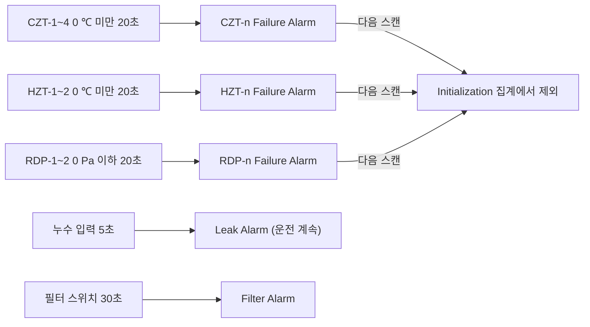

| 줄 | 코드 (요약) | 해석 |
| --- | --- | --- |
| 37~42 | `if VP_FWU_CZT-1 < 0 : if SECTIMER(0, 1) > 20 : CZT-1 Failure Alarm = 1 / else : 리셋, 0` | 1번 냉복도 온도가 0 ℃ 미만으로 20초 → 고장 |
| 45~66 | (CZT-2~4, 타이머 1~3) | 같은 모양 |
| 70~83 | (HZT-1~2, 타이머 4~5) | 같은 모양 |
| 87~101 | `if RDP-1 <= 0 :` (RDP-1~2, 타이머 6~7) | 차압은 0 이하이면 고장 |
| 105~110 | `if FWU_LEAK DETECT == 1 : 5초 → Leak Alarm = 1 / else : 리셋, 0` | 누수 감지 (QTS 142). 알람만, 장비 정지 없음. **신규 관제점이라 정의 후 사용** |
| 115~120 | `if FWU_FILTER ALARM == 1 : 30초 → Filter Alarm = 1 / else : 리셋, 0` | 필터 차압스위치 (QTS 104·141). 알람만 |

---

## 10. Alarm-3.py — 통신 이상 감시

**역할 한 줄:** 팬 8대, ATS, 유량계의 Modbus 통신이 10초 이상 끊기면 통신 이상 알람을 씁니다.

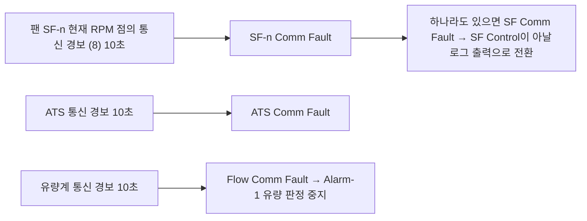

| 줄 | 코드 (요약) | 해석 |
| --- | --- | --- |
| 23~28 | `if READPOINT_ALARM("FWU SF-1.Current RPM") == 8 : 10초 → SF-1 Comm Fault = 1 / else : 0, 리셋` | 1번 팬 RPM 점에 통신 경보(8)가 10초 → 통신 이상 |
| 31~84 | (SF-2~8, 타이머 1~7) | 같은 모양 |
| 87~90 | `if SF-1~8 Comm Fault 중 하나라도 1 : SF Comm Fault = 1 else 0` | 종합 통신 이상. SF Control이 팬 출력을 아날로그로 바꾸는 기준 |
| 96~101 | `if READPOINT_ALARM("FWU-ATS.Current Power") == 8 : 10초 → ATS Comm Fault = 1` | ATS 통신 이상 (QTS 148) |
| 104~109 | `if READPOINT_ALARM("FWU-Flow.Rate") == 8 : 10초 → Flow Comm Fault = 1` | 유량계 통신 이상 (QTS 140) |

---

## 11. Remote Shutdown.py — 원격 정지와 연기 정지

**역할 한 줄:** 원격 정지 명령이 오거나, 연기가 감지되고 "정지"로 설정돼 있으면 FWU를 강제로 멈춥니다.

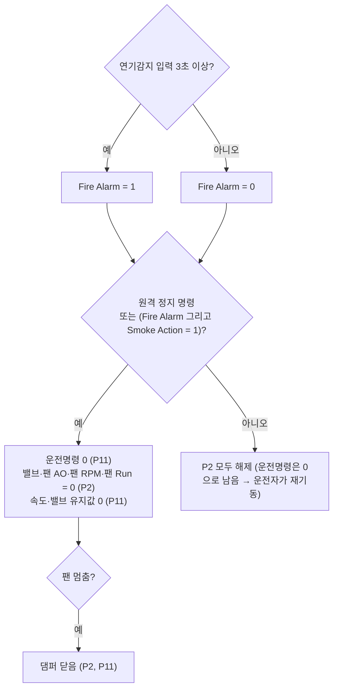

| 줄 | 코드 (요약) | 해석 |
| --- | --- | --- |
| 31~33 | `if FWU_FIRE ALARM == 1 : if SECTIMER(0, 1) > 3 : Fire Alarm = 1` | 연기감지기 접점이 3초 계속 ON이면 화재 알람 |
| 34~36 | `else : SECTIMER(0, 0)`, `Fire Alarm = 0` | OFF면 바로 해제 |
| 41 | `SHUTDOWN = 0` | 정지 여부 시작값 |
| 42~43 | `if Remote Shutdown Command == 1 : SHUTDOWN = 1` | BMS 원격 정지 명령 |
| 44~45 | `if Fire Alarm == 1 and Smoke Action == 1 : SHUTDOWN = 1` | 연기 감지 + "정지" 설정 (QTS 143). 설정 0이면 알람만 |
| 47 | `if SHUTDOWN == 1 :` | 정지해야 하면 |
| 48~49 | `Command / Command-HMI = 0 (P11)` | 운전명령 끔 |
| 50~51 | `PICV = 0 (P2, P11)` | 밸브 닫음 강제, 유지값도 0 |
| 52 | `Speed Value = 0 (P11)` | 수동 모드 유지값도 0 (해제 후 저절로 재기동 방지) |
| 53~62 | `SPEED CONTROL 2개, Target RPM 8개 = 0 (P2)` | 팬 출력 강제 0 |
| 63~70 | `SF-1~8 Run Command = 0 (P2)` | 팬 운전 지령 강제 OFF (BMS가 운전명령을 더 높은 우선순위로 1로 써도 팬이 멈춤) |
| 72~74 | `if SF Status == 0 : SAD COMMAND = 0 (P2, P11)` | 팬이 멈춘 뒤 댐퍼 닫음 |
| 75~96 | `else :` → `RELEASE_PRI(…, 2)` 20줄 | 정지가 풀리면 P2 강제값을 모두 지움. 운전명령은 0으로 남아 있어 자동 재기동 안 함 |

---

## 12. Failover.py — 용량 부족 알람

**역할 한 줄:** 이 FWU가 냉방을 제대로 못 하는 상황이 5초 계속되면 Failover 알람을 걸고 정지시켜, BMS PLC가 이웃 FWU에 백업 운전을 시키게 합니다.

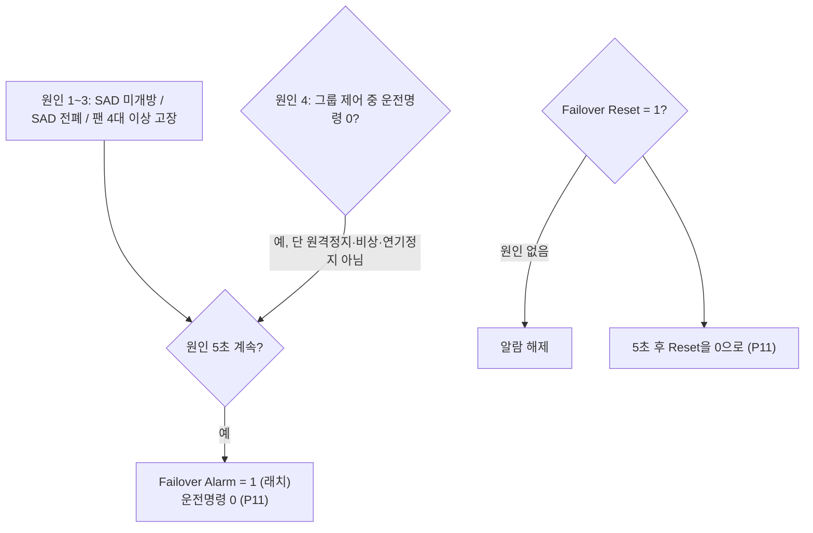

| 줄 | 코드 (요약) | 해석 |
| --- | --- | --- |
| 37 | `FAIL_TOTAL = 0` | 고장 원인 여부 시작값 |
| 40~41 | `if SAD Not Open or SAD Full Close or SF Failure : FAIL_TOTAL = 1` | 원인 1~3 |
| 45 | `if Group Control Mode == 1 and Command == 0 :` | 그룹 제어 중인데 운전명령이 꺼짐 |
| 46 | `if Remote Shutdown Command == 0 and FWU_EMERGENCY == 0 :` | 원격 정지·비상정지로 끈 게 아니고 |
| 47~48 | `if Fire Alarm == 0 or Smoke Action == 0 : FAIL_TOTAL = 1` | 연기 정지로 끈 것도 아니면 → 원인 4 |
| 53~56 | `if FAIL_TOTAL == 1 : if SECTIMER(1, 1) > 5 and 알람 0 : Failover Alarm = 1, Command = 0 (P11)` | 원인이 5초 계속되면 알람(래치)하고 한 번 정지 |
| 58~59 | `else : SECTIMER(1, 0)` | 원인이 없으면 타이머 리셋 (알람은 Reset 전까지 유지) |
| 64~66 | `if Failover Reset == 1 : if FAIL_TOTAL == 0 : Failover Alarm = 0` | 운전자가 Reset하면 원인이 없을 때만 해제 |
| 69~71 | `if SECTIMER(2, 1) > 5 : Reset = 0 (P11)` | Reset을 5초 유지 후 0으로 되돌림 |
| 72~73 | `else : SECTIMER(2, 0)` | |

---

## 13. 상황별 동작 요약

| 상황 | 팬 | 냉수밸브 | 댐퍼 | 알람 |
| --- | --- | --- | --- | --- |
| 정상 자동 운전 | 선택 모드 PI | SAT PI | 열림 | - |
| BMS PLC 통신 이상 (RDP·CZT·원격 고정값) | 마지막 속도 유지 또는 최대 | SAT PI | 열림 | BMS PLC Comm Fault |
| 백업 운전 지령 | 최대 | SAT SP − 0.5 ℃ | 열림 | - |
| 급기온도 센서 고장 | 모드대로 | 100 % | 열림 | SAT Failure |
| 팬 1대 고장 | 나머지 운전 | SAT PI | 열림 | SF-n Run Fail |
| 팬 4대 이상 고장 | 정지 (Failover) | 0 % | 닫힘 | SF Failure, Failover |
| 연기 감지, Smoke Action 0 | 계속 | 계속 | 열림 | Fire Alarm |
| 연기 감지, Smoke Action 1 | 정지 (P2) | 0 % (P2) | 닫힘 | Fire Alarm |
| 누수 감지 | 계속 | 계속 | 열림 | Leak Alarm |
| 원격 정지 | 정지 (P2) | 0 % (P2) | 닫힘 | - |
| 비상정지 | 정지 (P1) | 0 % (P1) | 닫힘 (P1) | - |
| 팬 통신 이상 | 아날로그 출력으로 운전 | SAT PI | 열림 | SF Comm Fault |

---

## 14. 함께 볼 문서

| 문서 | 내용 |
| --- | --- |
| `QTS_FWU_Logic_Revision_Review.md` | QTS 대비 반영 현황, 변경 내역, 남은 작업 |
| `QTS_신규_관제점_목록.xlsx` | 신규 관제점 9점: 로직 반영 7점 + 냉수 입·출수 온도 2점(부품 미확정) |
| `QTS_SW_통신_관제점_반영현황.xlsx` | QTS 소프트웨어·통신·관제점 반영 현황표 |
| `LDPL Programming Guide-v27.pdf` | DDC 로직 함수 설명서 |
