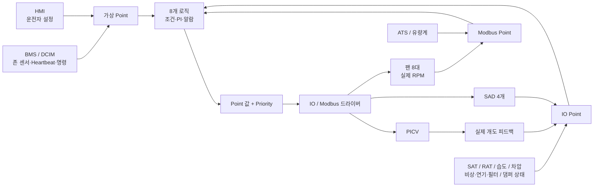
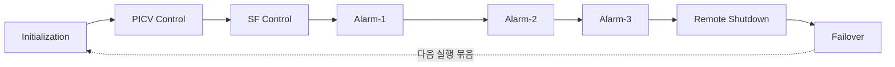

# FWU v1 제어로직 스터디 가이드

> 작성일: 2026-11-16 · Python/DDC 입문자용
>
> **학습 목표:** 8개 파일을 처음부터 외우지 않고, “무엇을 읽고 → 어떤 조건으로 판단하고 → 어디에 어떤 우선순위로 쓰는가”를 따라갈 수 있게 한다.
>
> 실제 변경 목록·RFP 판정·XML 신규점 전체·미결항목은 [FWU_v1_change_analysis.md](FWU_v1_change_analysis.md)에 있다. 이 문서는 개념과 코드 읽기, 대표 운전 사례를 중심으로 설명한다. 기존 학습 자료를 수정하거나 대체한 것이 아니라, 지정된 A/B 비교를 위한 새 학습 자료다.

## 1. 추천 학습 순서

| 단계 | 읽을 내용 | 스스로 답할 질문 |
|---|---|---|
| 1 | 이 문서 §2의 설비/신호 구조 | 팬·밸브·댐퍼가 각각 무엇을 바꾸는가? |
| 2 | §3의 Python 기본 문법과 Point | Python 변수와 DDC Point는 무엇이 다른가? |
| 3 | §4의 스캔/우선순위/타이머 | “0 쓰기”와 “Release”는 왜 다른가? |
| 4 | §5의 파일 역할과 코드 지도 | 팬 운전명령을 만드는 파일과 팬 상태를 판단하는 파일은 무엇인가? |
| 5 | §6의 PI 및 출력 환산 | PV/SP/출력/PI 시작값/실제 RPM을 구분할 수 있는가? |
| 6 | §7의 핵심 A/B 코드 비교 | 기본 동작은 같은데 어떤 장애 상황에서 달라지는가? |
| 7 | §8의 사례를 실제 코드와 번갈아 읽기 | 입력에서 실제 장비까지 다섯 단계를 설명할 수 있는가? |
| 8 | §9 체크리스트와 종합 보고서 | 구현·정의·외부맵·검증을 구분하여 검토할 수 있는가? |

**파일을 직접 읽는 추천 순서:**

1. [DDC 등록 순서](../FWU_v1/DDC.xml#L15-L22)와 [주요 IO](../FWU_v1/ControlPoint/IO.xml#L22-L51).
2. [PICV 제어](../FWU_v1/Logic/PICV%20Control.py#L32-L63): 가장 짧은 자동/수동/비상 구조부터 익힌다.
3. [SF 기동·정지](../FWU_v1/Logic/SF%20Control.py#L128-L269): 먼저 PI 내부 인자를 건너뛰고 조건문 골격을 본다.
4. [Initialization](../FWU_v1/Logic/Initialization.py#L56-L356): 앞에서 본 상태/PV가 어디서 생겼는지 확인한다.
5. [Alarm-3](../FWU_v1/Logic/Alarm-3.py#L23-L109) → [Alarm-2](../FWU_v1/Logic/Alarm-2.py#L37-L120) → [Alarm-1](../FWU_v1/Logic/Alarm-1.py#L62-L437): 짧은 반복 패턴부터 복합 알람으로 간다.
6. [Remote Shutdown](../FWU_v1/Logic/Remote%20Shutdown.py#L31-L96) → [Failover](../FWU_v1/Logic/Failover.py#L35-L64): 강제 출력 정지와 일회 명령 정지를 비교한다.
7. 마지막에 [팬 PI 선택](../FWU_v1/Logic/SF%20Control.py#L77-L187)과 [통신맵](../FWU_v1/ProtocolSerivce/Modbus/ModbusServiceInfo.xml#L3-L373)을 읽는다.

이 학습 순서와 **실제 로직 등록 순서**는 다르다. 공부하기 편한 순서로 읽되 실행 흐름은 §4.1을 따른다.

## 2. 설비부터 이해하기

### 2.1 FWU 한 대에서 일어나는 일

- **SF(Supply Fan) 8대:** 공기를 움직인다. 빨리 돌면 일반적으로 풍량이 증가한다.
- **PICV:** 냉수 코일에 흐르는 물을 조절한다. 냉수가 정상 공급되는 조건에서 더 열면 공기를 더 냉각할 수 있다.
- **SAD(Supply Air Damper) 4개:** 바람이 나가는 통로를 열고 닫는다. 명령은 공통 DO 하나지만 열림/닫힘 상태는 각 댐퍼에서 따로 받는다.
- **DDC:** 센서/명령을 읽고 팬·밸브·댐퍼에 제어값을 쓴다. 장비가 실제로 명령대로 움직였는지는 피드백으로 다시 판단한다.
- **BMS/DCIM:** 상위 감시·명령 시스템. 원격 존 센서값과 Heartbeat를 공급하고 여러 FWU의 조율을 담당하도록 설계되어 있다. 상위 프로그램 자체는 이 저장소에 없다.
- **ATS:** 두 전원 사이 자동 절체를 담당하는 장치. 이 Python은 상태/통신을 감시할 뿐 절체 동작을 직접 구현하지 않는다.



위 화살표는 **설계상 신호 경로**다. 현재 누수 입력/일부 VP/Heartbeat 통신맵이 빠져 있으므로 그림만 보고 모든 연결이 완성되었다고 판단하지 않는다. 보고서 U01~U03을 함께 본다.

### 2.2 자주 나오는 약어

| 이름 | 뜻 | 코드에서 하는 일 |
|---|---|---|
| SAT | 급기온도 | PICV가 맞추는 온도. 방으로 보내는 공기 |
| RAT | 환기온도 | 돌아오는 공기 온도. 팬 모드 1의 PV |
| SAH / RAH | 급기/환기 습도 | 감시·상하한·고장 알람 |
| CZT / HZT | 냉복도/열복도 온도 | BMS가 VP에 공급. CZT는 팬 모드 4, HZT는 감시 |
| CZH | 냉복도 습도 | 4개 값 집계. 온도센서와 같은 고장 제외 로직은 없음 |
| RDP | 실 차압 | 팬 모드 2의 PV. 현재 제어는 유효센서 평균 또는 최소 |
| SAFLOW DP | 급기 풍량 산출용 차압 | 풍량 계산, 팬 통신 이상 시 대체 운전/고장 판정 |
| ΔT | RAT−SAT | 공기 온도차. 팬 모드 3의 PV |
| PV | 현재 측정/대표값 | 제어가 지금 보고 있는 값 |
| SP | 목표/설정값 | 맞추고 싶은 값 |
| CV / Output | 제어 출력값 | 팬 속도 % 또는 밸브 개도 % |
| RPM | 분당 회전수 | 팬 실제값/목표값. %와 다른 단위 |
| LPM / CMH | L/min / m³/h | 냉수 유량 / 공기 풍량. 서로 바꾸어 읽으면 안 됨 |

**RDP와 SAFLOW DP는 다른 센서다.** RDP가 낮다는 이유와 팬 통신 이상 중 SAFLOW DP가 낮다는 이유는 전혀 다른 분기에 사용된다.

## 3. Python 변수와 DDC Point

### 3.1 이름에 따옴표가 있는지 먼저 보기

[초기화 예](../FWU_v1/Logic/Initialization.py#L56-L60):

```python
HB = engine.READPOINT("VP_FWU_BMS PLC Heartbeat")
if HB != engine.READPOINT("VP_FWU_BMS PLC Heartbeat Prev") :
	engine.WRITEPOINT("VP_FWU_BMS PLC Heartbeat Prev", HB)
	engine.SECTIMER(6, 0)
	HB_OK = 1
```

- `HB`, `HB_OK`는 현재 실행의 Python 변수다. 이 코드에서는 실행할 때 다시 계산한다.
- `"VP_FWU_BMS PLC Heartbeat"`는 **Point 이름 문자열**이다. 실제 값은 DDC 엔진에서 읽는다.
- `Heartbeat Prev` Point에 저장해야 다음 초기화 실행에서도 이전 읽기값과 비교할 수 있다.
- `engine`은 첫 줄 `engine = ddc_logic()`로 얻는 DDC 전용 기능 객체다. 일반 Python에 기본 제공되는 함수가 아니다. PC에서 파일을 그대로 실행해도 DDC·장비를 재현하지 못한다.

### 3.2 Point 종류

| 타입 | 예 | 값의 출처 |
|---|---|---|
| AI | `FWU_SAT`, `FWU_PICV FEEDBACK` | 연속 센서 입력 |
| DI | `FWU_FIRE ALARM`, `REMOTE SELECTION` | 접점/스위치 입력 |
| AO | `FWU_PICV CONTROL`, 팬 SPEED CONTROL | 연속 출력 명령 |
| DO | `FWU_SAD-1_4 COMMAND` | 개폐 출력 명령 |
| AV | `VP_FWU_Speed SP`, `VP_FWU_CZT PV` | 설정값/계산 결과 |
| DV | `VP_FWU_Command`, `VP_FWU_Failover Alarm` | 이산 명령/상태/알람 |

AI/AO 같은 타입 표기는 IO뿐 아니라 Modbus 관제점에도 사용된다. **타입만 보고 실제 전선 입력인지 통신 입력인지 구분하면 안 된다.** 어느 ControlPoint 파일에 정의되어 있는지 함께 본다.

### 3.3 필요한 Python 문법만 익히기

| 문법 | 뜻/주의 |
|---|---|
| `=` | 값을 대입한다. `HB_OK = 1` |
| `==`, `!=` | 같은지/다른지 비교한다 |
| `>`, `<`, `>=`, `<=` | 경계값 포함 여부가 다르다. `>5`는 정확히 5를 포함하지 않음 |
| `and`, `or`, `not` | 모두 참 / 하나라도 참 / 반대 |
| `if ... :` / `else :` | 조건이 참일 때 / 거짓일 때 실행. 들여쓰기가 범위를 결정 |
| `a < b < c` | `a < b and b < c`. PICV 편차 판정에 등장 |
| `x ** 0.5` | x의 제곱근. 음수값 사용 여부에 주의 |
| `#` | 주석. 실행하지 않음. 과거 이력이나 현재 코드와 다른 설명도 있을 수 있음 |

**독립된 두 `if`는 두 번 다 실행될 수 있다.** SF에서는 전개방 조건의 제어를 실행한 뒤 전폐 조건도 별도로 검사한다. OPEN/CLOSE 신호가 모순되게 모두 1이면 뒤의 전폐 분기에서 P5 속도=0을 쓴다. 이런 검토는 들여쓰기와 실행 순서를 읽어야 가능하다.

`if`가 거짓이라 쓰지 않았다고 자동으로 값이 0이 되는 것도 아니다. **이전 Point 값/우선순위 슬롯이 남는다.** 속도 유지, 히스테리시스, 래치가 이 성질을 사용한다.

## 4. 반드시 이해할 DDC 핵심 개념

### 4.1 스캔: 로직이 한 번 끝나도 설비 운전은 계속된다

[등록 순서](../FWU_v1/DDC.xml#L15-L22):



공부할 때 이 한 묶음을 **스캔**이라고 부른다. 실제 엔진이 등록 순서대로 반복 실행하고 Point 쓰기가 다음 로직에서 보인다는 전제로 해석한다. **전체 스캔이 정확히 1초인지, IO가 언제 갱신되는지는 XML에서 확정되지 않는다.**

- 초기화가 앞에서 계산한 `SF Status`는 뒤의 PICV가 읽는다.
- Alarm-2가 뒤에서 확정한 센서 고장값은 다음 초기화 실행에서 반영된다.
- Alarm-3의 통신 알람도 다음 팬 제어에 반영된다. 헤더의 “Initialization 앞에 등록”이라는 설명과 실제 등록은 다르다.
- Failover가 마지막에 Command=0을 써도, 이미 실행한 SF/PICV의 일반 정지 분기가 과거로 돌아가 실행되는 것은 아니다.

### 4.2 명령·피드백·상태는 서로 다르다

| 단계 | 예 | 뜻 |
|---|---|---|
| 요청 | `VP_FWU_Command=1` | FWU를 켜고 싶다 |
| 계산 결과 | `VP_FWU_SF Speed Value=50` | 팬 속도를 50%로 하겠다는 내부값 |
| 출력 명령 | `Target RPM Set=862.95` | 드라이버가 팬으로 보낼 목표 |
| 실제 피드백 | `Current RPM=850` | 팬이 보고한 실제 회전수 |
| 가공 상태 | `VP_FWU_SF Status=1` | RPM/차압과 지연조건으로 “하나 이상 운전 중” 판단 |

팬 Status=1은 **8대 모두 정상**이라는 뜻이 아니다. 팬 한 대가 돌기만 해도 조건이 충족될 수 있다. 밸브 CONTROL=0도 실제 FEEDBACK=0이나 실제 유량=0을 보증하지 않는다.

### 4.3 우선순위: 여러 사람이 같은 출력에 요청할 때

Point마다 번호가 붙은 명령 칸이 있다고 생각하면 된다. 이 코드의 우선순위 의도는 작은 번호가 우선하는 **P1 → P2 → P5 → P11**이다.

| 우선순위 | 작성자 | 용도 |
|---|---|---|
| P1 | SF/PICV 비상 분기 | 비상 팬/밸브 출력 0, 팬 정지 후 댐퍼 닫힘 |
| P2 | Remote Shutdown | 원격/선택 연기 정지 출력 0. B는 Run도 포함 |
| P5 | 일반 로직 | 자동 제어 및 팬 출력 변환 |
| P11 | 미러·운전명령·Reset | 수동 전환 시 값 보관, 정지요청, Reset 0복귀 |

예를 들어 Target RPM의 P5=1200, P2=0이면 유효값은 0이다. `RELEASE_PRI(...,2)`는 **P2를 0으로 쓰는 것이 아니라 칸을 비워** P5=1200을 다시 드러낸다. 그 전에 P5가 안전한 값으로 정리됐는지를 확인해야 한다.

```python
engine.WRITEPOINT_PRI("FWU SF-1.Target RPM Set", 0, 2)
```

위는 [정지 시 P2 강제](../FWU_v1/Logic/Remote%20Shutdown.py#L55)다. 정지 조건이 풀리면 [같은 점 P2 해제](../FWU_v1/Logic/Remote%20Shutdown.py#L80)를 한다. 낮은 우선순위 쓰기는 높은 우선순위 값을 지우지 않는다.

**자동→수동:** 자동은 계산값을 P5에 쓰고 유효값을 P11에도 복사한다. 수동 전환 시 P5를 비우면 P11에 보관된 값부터 이어갈 수 있다. 실제 HMI/BMS가 어느 우선순위를 사용하는지는 현재 XML에서 확정되지 않았다. “HMI는 반드시 P11”이라는 사실로 외우지 않는다.

**Failover와 비상정지 차이:** Failover는 Command P11=0을 한 번 요청한다. 비상정지는 팬·밸브 출력 자체에 P1=0을 쓴다. 수동모드나 높은 외부 Command가 있을 때 결과가 달라질 수 있다.

### 4.4 SECTIMER: 기다리면서 다른 일도 하는 초시계

실제 [센서 고장 코드](../FWU_v1/Logic/Alarm-2.py#L37-L42):

```python
if engine.READPOINT("VP_FWU_CZT-1") < 0 :
	if engine.SECTIMER(0, 1) > 20 :
		engine.WRITEPOINT("VP_FWU_CZT-1 Failure Alarm", 1)
else :
	engine.SECTIMER(0, 0)
	engine.WRITEPOINT("VP_FWU_CZT-1 Failure Alarm", 0)
```

- 0은 **타이머 번호**, 두 번째 1은 **현재값 읽기 옵션**이다.
- 두 번째 인자 0은 리셋이다. `SECTIMER(0,0)`은 0초 기다리라는 뜻이 아니다.
- 센서가 정상으로 돌아오면 초시계를 리셋한다. 다시 나빠지면 지연 확인을 새로 시작하는 구조다.
- `>20`이므로 20초에 딱 맞춰 알람이라고 표현하지 않는다. 정수 초 반환/스캔 시점/초기 상태가 실제 지연에 영향을 준다.
- LDPL은 로직당 10개(0~9)를 제공한다. Alarm-1의 0번과 Alarm-2의 0번은 문서상 서로 다른 로직의 타이머다.
- `WAIT`처럼 파일 실행을 멈추는 함수가 아니다. 이 파일들은 `WAIT`를 사용하지 않는다.

**가장 중요한 예외 — 팬 60초:** [팬 고장 허용 타이머](../FWU_v1/Logic/Alarm-1.py#L176-L179)의 바깥 조건은 고장 여부가 아니라 `Command=1 AND Speed≥Min`이다. 따라서 “팬이 60초 동안 고장 나야 알람”이 아니다. 이미 60초 이상 운전 조건이 유지됐다면 새 RPM 고장은 다음 판단에서 즉시 잡힐 수 있다.

### 4.5 지연·히스테리시스·래치는 다르다

| 개념 | 기억하는 것 | 예 |
|---|---|---|
| 지연 | 조건이 성립한 시간 | 센서 이상 >20초, 연기 입력 >3초 |
| 히스테리시스 | 마지막 알람값, 서로 다른 ON/OFF 기준 | RAT>상한이면 1, RAT<상한−0.5면 0, 사이에서는 유지 |
| 래치 | 한 번 발생한 사건 | Failover는 원인 해소만으로 0이 되지 않고 Reset 필요 |

누수·필터·Fire 알람은 입력이 해소되면 0으로 돌아가는 **비래치**다. BMS Comm Fault와 Failover는 Reset 절차가 있는 래치다. SAD Full Close는 특정 조건에서 자기 상태를 유지하는 조건부 유지다. 알람 이름에 Alarm이 붙었다고 모두 래치라고 생각하지 않는다.

## 5. 파일별 역할과 읽기 지도

### 5.1 Initialization: 다른 파일이 쓸 공통 정보를 준비

**흐름:** Heartbeat → BMS 정상여부 → 유효 존 센서 집계 → PV 선택 → ΔT → 팬 Status → 풍량 → Local/Remote Command 복사 → 최대 RPM.

중요 변수:

| 변수/Point | 뜻 |
|---|---|
| `HB`, `HB_OK` | 현재 Heartbeat, 마지막 변화 후 타임아웃이 지나지 않았는지 |
| `BMS_OK` | 래치 통신 알람이 0인지 |
| `CZT_CNT`, `CZT_SUM` | 집계에 포함한 센서 수, 값의 합 |
| `CZT_MAXV`, `CZT_MINV` | 집계 중 최대/최소. 초기 −1000/1000은 찾기용 시작값 |
| `PV Valid` | 쓸 센서가 존재하는지. PV=0인 값과 따로 읽어야 함 |
| `SF1_CF`~`SF8_CF` | 팬별 통신 이상 읽기값 |
| `SF_RUN` | 이번 실행의 팬 운전 판정 후보. 지연 후 SF Status에 반영 |
| `RUN_DP`, `FAIL_RPM` | 통신 이상 대체차압 기준, 정상통신 RPM 기준 |

[CZT 집계](../FWU_v1/Logic/Initialization.py#L84-L124)를 한 블록만 이해한 뒤 HZT/RDP 반복을 읽는다. 건강한 센서를 세어 나누므로 4개 중 1개만 유효해도 4로 나누지 않는다. 전부 무효면 나누기 대신 0/Valid0을 쓴다.

**주의:** “유효”는 현재 코드의 Failure Alarm과 BMS 상태를 통과했다는 뜻이다. 고착값, 비현실적 고온, 통신 데이터 나이 등을 전부 검사했다는 뜻이 아니다. CZH는 같은 필터가 없다.

### 5.2 PICV: 조건이 맞을 때만 SAT PI

[제어 블록](../FWU_v1/Logic/PICV%20Control.py#L36-L63)을 다음 질문 순서로 읽는다.

1. 비상 입력이 0인가? 아니면 P1/P11=0.
2. 자동모드인가? 아니면 PI 초기화·P5 Release.
3. Command=1이고 팬 Status=1인가? 이때 SAT 고장 100% 또는 PI.
4. Command=0인가? 이때 PI 초기화·밸브 0.
5. 자동이면 현재 유효값을 P11에도 복사한다.

3과 4 사이에는 `Command=1, SF Status=0`이라는 빈 조건이 있다. 이때 새로운 밸브값을 쓰지 않는다. 따라서 “팬이 멈추면 항상 밸브 닫힘”이라고 일반화하면 안 된다.

### 5.3 SF: 속도 계산과 출력은 두 단계

**앞부분:** 제어모드·BMS 상태 → 자동/수동/비상 → 댐퍼 상태 → Speed Value.

**뒷부분:** Speed Value>0이면 Run=1 → 타이머가 >5이면 Modbus RPM 또는 AO 계산·출력.

| 제어모드 `SF Control Select` | PV | 목표 | B의 방향 |
|---|---|---|---|
| 0 고정값 | PI 없음 | Speed SP | Min~Max로 제한 |
| 1 RAT | FWU_RAT | RAT SP | RAT 높으면 팬출력 증가 방향 |
| 2 RDP | RDP PV | RDP SP | 차압 낮으면 팬출력 증가 방향 |
| 3 ΔT | RAT−SAT | DeltaT SP | ΔT 높으면 팬출력 증가 방향 |
| 4 CZT | CZT PV | CZT SP | 냉복도 온도 높으면 팬출력 증가 방향 |

`FIXED`는 고정값 대체가 필요한지, `BMS_FAIL`은 이 모드에서 BMS 이상 대응을 적용할지 나타낸다. `BMS_FAIL=1`일 때 FIXED를 0으로 바꾸는 이유는 **센서 고장용 Speed SP 대체보다 통신 이상용 유지/최대 분기를 적용하기 위해서**다.

### 5.4 Alarm 세 파일: 고장 종류별로 나누어 보기

| 파일 | 주요 내용 | 대표 타이머 |
|---|---|---|
| Alarm-1 | 상하한, 팬 실패, 자체 센서, 댐퍼, 밸브/유량 | 0~9 모두 사용 |
| Alarm-2 | BMS 존 센서 고장, 누수, 필터 | 0~7 센서, 8 누수, 9 필터 |
| Alarm-3 | 팬 8대·ATS·유량계 통신 | 0~7 팬, 8 ATS, 9 유량계 |

Alarm-1의 `SF1_FAIL` 같은 내부 참/거짓 값과 `VP_FWU_SF-1 Run Fail Alarm`은 별개다. A에서는 내부 판단만 있었고 B에서 결과 Point 기록이 추가되었다.

팬 실패는 기본값에서 **8대 중 4대 이상**이어야 종합 SF Failure가 된다. 1대 고장 알람이 났다고 이 코드가 해당 팬을 따로 정지시키거나 다른 팬에 자동 추가 속도를 배분하는 분기는 없다.

### 5.5 Remote Shutdown과 Failover: 정지 방식이 다르다

| 비교 | Remote/선택 연기 정지 | Failover |
|---|---|---|
| 출발 | 정지 명령 또는 연기+설정 | 댐퍼 미개방/전폐/팬 종합 고장 |
| 지연 | 원격명령 자체는 별도 지연 없음, 연기 확인 >3초 | 원인 OR >5초 |
| 출력 강제 | 팬/밸브 P2=0, B는 팬 Run도 P2=0 | 출력 P1/P2 강제 없음, Command P11=0 |
| 유지 | 조건이 있는 동안 반복 강제 | 알람을 래치, 정지명령은 알람 발생 시 한 번 |
| 복귀 | 조건 해소 후 P2 Release | 원인 없을 때 Reset으로 알람 해제 |
| 상위 역할 | 정지요청·감시 | 알람을 보고 이웃 Backup을 구현해야 함 |

비상정지는 SF/PICV 자체에서 P1을 사용한다. 위 세 방식을 모두 “정지”라고 부르지만 우선순위·수동운전·재기동에서 차이가 난다.

## 6. DDC 함수와 PI 제어

### 6.1 자주 사용하는 함수

| 함수 | 인자 | 하는 일 | 근거/주의 |
|---|---|---|---|
| `ddc_logic()` | 없음 | DDC 전용 엔진 객체 획득 | 모든 로직 첫 줄, PC 표준 Python 내장 아님 |
| `READPOINT(name)` | Point 이름 문자열 | 현재 Point 값 읽기 | LDPL 예제 사용. 미정의점 반환/오류는 미확인 |
| `WRITEPOINT(name,value)` | 이름, 쓸 값 | 일반 제어값 기록 | LDPL §4.2에서 기본 우선순위 5 설명 |
| `WRITEPOINT_PRI(name,value,priority)` | 이름, 값, 1~16 | 지정 Priority 기록 | 가이드 p.54 본문은 WRITE_PRI, p.3 이력은 WRITEPOINT_PRI |
| `RELEASE_PRI(name,priority)` | 이름, 1~16 | 지정 슬롯 해제 | LDPL §4.3 p.55. 값을 0으로 쓰는 것과 다름 |
| `READPOINT_ALARM(name)` | 이름 | 코드에서는 장치 Point의 알람 속성을 읽는 용도 | LDPL §4.10 p.62는 ALARM이라는 이름. 런타임 호환성 미확인 |
| `SECTIMER(index,options)` | 0~9, 0/1 | 0 reset / 1 현재 초 읽기 | LDPL §6.2 pp.72–73. 파일별 자원 |
| `MAX(...)`, `MIN(...)` | 비교 값, 최대 5개 | 최대/최소 | LDPL §§3.3–3.4 pp.33/35. 8팬 비교는 중첩 사용 |
| `LOOP2(...)` | 아래 13개 | 오차에 따라 제어 출력 계산 | LDPL §7.3 pp.80–81 |
| `LOOP2_INIT(loop_id)` | 0~9 | 해당 루프의 누적 상태 초기화 | LDPL §7.4 p.82. 출력값=0을 쓰는 함수가 아님 |

출처: [../LDPL Programming Guide-v27.pdf](../LDPL%20Programming%20Guide-v27.pdf). API 이름이 다른 경우 이름을 고쳐 실행하거나 동일함을 가정하지 않았다. **특히 `READPOINT_ALARM==8`은 가이드에서 8이 통신 경보라는 의미만 확인되었고 함수명 지원·복합 알람 처리까지 검증된 것은 아니다.**

### 6.2 PI의 직관

PI는 “목표와 현재가 다르면 출력을 조절하는 자동 조절기”다.

- **P(비례):** 지금 오차가 얼마나 큰지에 반응한다.
- **I(적분):** 오차가 계속 남아 있는 정도를 누적해 반응한다.
- **D(미분):** 이 코드의 모든 LOOP2에서는 인자가 0이므로 사용하지 않는다.
- **최소/최대:** 제어 출력 범위를 제한한다.
- **초기화:** 정지/모드전환 중 잘못된 누적값이 다음 제어에 남지 않도록 한다. 모든 분기에 초기화가 있는지는 코드를 따로 봐야 한다.

일반 PI 개념을 설명하면 $u \approx u_0 + K_p e + K_i\int e\,dt$ 형태다. **이 식은 학습용 개념식이지 LDPL 내부 수치 구현을 재현한 식이 아니다.** 게인 2000을 그대로 표준 PI의 $K_p=2000$이라고 대입해 계산하지 않는다.

### 6.3 실제 LOOP2 13개 인자 읽기

[B의 PICV 실제 호출](../FWU_v1/Logic/PICV%20Control.py#L47):

```python
engine.LOOP2(1, "FWU_SAT", "FWU_PICV CONTROL", "VP_FWU_PICV SAT SP", PICV_P, PICV_I, 0, 1, 100, engine.READPOINT("VP_FWU_PICV MinSP"), 100, 1, 0)
```

| 순서 | 인자 | 이 호출의 값 | 해석 |
|---:|---|---|---|
| 1 | `type` | 1 | 냉방 방향. SAT가 목표보다 높을 때 개방을 늘리는 방향 |
| 2 | `pv_point` | FWU_SAT | 현재 급기온도 Point **이름** |
| 3 | `cv_point` | FWU_PICV CONTROL | 계산 결과를 쓸 Point **이름** |
| 4 | `set_point` | VP_FWU_PICV SAT SP | 목표온도 Point **이름** |
| 5 | `p_gain` | PICV_P | 비례 게인. 앞에서 Point 값을 읽은 Python 변수 |
| 6 | `i_gain` | PICV_I | 적분 게인 |
| 7 | `d_gain` | 0 | 미분항 미사용 |
| 8 | `sampling_time` | 1 | 루프 계산 주기 1초. 전체 로직 스캔주기와 별개 |
| 9 | `start_control_value` | 100 | 제어 시작값. 밸브 % Point에 대한 값 |
| 10 | `minimum_control_value` | MinSP 읽은 값 | PI 출력 하한 |
| 11 | `maximum_control_value` | 100 | PI 출력 상한 |
| 12 | `loop_id` | 1 | 이 로직에서 사용할 루프 상태 번호 |
| 13 | `dead_band` | 0 | 오차 불감대 설정 |

팬 LOOP2는 출력 시작값 **60**, sampling_time **0(가이드상 기본1초)**, 하한/상한은 SF Speed Min/Max다. [팬 RAT 호출](../FWU_v1/Logic/SF%20Control.py#L148)에서 직접 확인한다. XML의 `SF Speed Start Value=50`은 이 호출에 연결되어 있지 않다.

**주의할 두 가지:**

1. type의 방향은 **PV를 낮추려는지/높이려는지**와 장비의 물리적 효과를 함께 본다. p.81 냉방 예제에는 type 숫자와 설명의 모순이 있으므로 본문 표 및 pp.114–115의 냉방/차압 예제를 함께 보아야 한다.
2. PICV loop 1과 SF loop 1을 같은 상태라고 생각하지 않는다. 가이드는 로직별 자원을 설명한다. SF 안에서는 같은 출력점에 모드별 loop 1~4를 사용하므로 엔진의 실제 지원과 초기화 동작을 확인해야 한다.

### 6.4 팬 %를 실제 RPM과 AO로 바꾸기

[출력 계산](../FWU_v1/Logic/SF%20Control.py#L280-L309)과 [최대RPM](../FWU_v1/Logic/Initialization.py#L356)을 연결해서 읽는다.

**예시 가정:** XML 기본값을 적용하고, 자동 고정값 속도가 50%, 팬 통신이 정상이다.

1. 설계RPM 1569 × 최대비율110/100 = **1725.9 rpm**.
2. 정격1920보다 작으므로 최대RPM=1725.9.
3. 속도50% × 최대RPM1725.9 /100 = **862.95 rpm** 목표.
4. 통신 정상 → Target RPM=862.95, AO=0.
5. 팬 하나가 통신 불량으로 확정 → 두 AO 모두 $50\times1725.9/1920=44.9453125\%$, 모든 Target RPM=0.

AO가 0~100%=0~10V로 정상 변환되는 장치라면 약 **4.49V**에 해당한다. 이는 XML/코드에 기반한 환산 예시이지 실제 출력전압 측정 결과가 아니다. 기본값도 현장 현재값과 같다고 보증할 수 없다.

### 6.5 ΔT 방향을 바꾼 이유

일정한 열부하를 운반한다는 단순화 아래,

$$
Q \approx \dot m c_p (RAT-SAT)
$$

풍량/질량유량 $\dot m$이 줄면 같은 열량을 운반하기 위한 ΔT는 커질 수 있다. 따라서 ΔT가 목표보다 크면 팬을 더 돌려 ΔT를 줄이는 방향이 의도에 맞는다. A는 type0, B는 type1이다.

다만 실제 설비는 밸브 PI·냉수온도·실내부하도 함께 변한다. “type1로 바꿨으니 항상 안정”이라고 결론내릴 수 없다. 특히 [DeltaT SP 기본값 −2](../FWU_v1/ControlPoint/VirtualPoint.xml#L39)는 일반적인 양의 RAT−SAT와 맞지 않을 수 있어 사용 전 설계값을 확인해야 한다.

## 7. A/B 핵심 코드 비교로 익히기

전체 diff는 종합 보고서에 있다. 아래는 변경을 이해하기 위한 **실제 코드의 핵심 발췌**다. 실행용 대체 파일이나 수정안이 아니다.

### 7.1 ΔT: 함수 이름은 같아도 인자 하나가 동작을 바꾼다

| A | B |
|---|---|
| [type0 ΔT 호출](../SMX01-FWU-20261102/FWU-F8-ATS/Logic/SF%20Control.py#L131) | [type1 ΔT 호출](../FWU_v1/Logic/SF%20Control.py#L163) |

두 호출은 PV/SP/출력/게인/시작값이 같고 첫 인자의 방향이 다르다. 줄 수가 한 줄만 바뀌어도 실제 제어 효과는 크다.

### 7.2 팬별 고장: 새 센서가 아니라 결과를 저장하기 시작

[A](../SMX01-FWU-20261102/FWU-F8-ATS/Logic/Alarm-1.py#L214-L232)는 `SF1_FAIL`이 참이면 고장 수를 더하는 방식이었다. [B](../FWU_v1/Logic/Alarm-1.py#L230-L235)는 여기에 결과 Point 쓰기를 추가했다.

```python
SF_FAIL_CNT = 0
if SF1_FAIL :
	SF_FAIL_CNT = SF_FAIL_CNT + 1
	engine.WRITEPOINT("VP_FWU_SF-1 Run Fail Alarm", 1)
else :
	engine.WRITEPOINT("VP_FWU_SF-1 Run Fail Alarm", 0)
```

`Run Fail Alarm` 점 자체는 A에도 있었다. B의 변화는 **새 Point 생성이 아니라 기존 Point 사용 시작**이다. 이 값이 BMS 화면까지 전달되려면 외부맵과 화면이 필요하며 현재 Modbus 결과맵은 없다.

### 7.3 숫자 4를 설치 팬 수의 절반으로

[A 기준](../SMX01-FWU-20261102/FWU-F8-ATS/Logic/Alarm-1.py#L233):

```python
if SF_FAIL_CNT >= 4 :
```

[B 기준](../FWU_v1/Logic/Alarm-1.py#L274):

```python
if SF_FAIL_CNT * 2 >= engine.MAX(engine.READPOINT("VP_FWU_SF Count"), 1) :
```

기본 Count=8이면 같다. 5라면 수학적으로 3대부터 참이다. **하지만 코드는 여전히 SF-1~8을 모두 검사**하므로 Count=5만 넣어 팬 5대 모델로 변신하는 것은 아니다. `MAX(...,1)`도 잘못된 모든 값을 정상 설정으로 만드는 기능은 아니다.

### 7.4 Backup 제거: Point 이름이 남았다고 기능도 남는 것은 아니다

[A PICV](../SMX01-FWU-20261102/FWU-F8-ATS/Logic/PICV%20Control.py#L32-L36)는 Backup=1·자체 Failover=0일 때 Active SP를 0.5℃ 낮췄다. A 팬은 [전개방 상태에서 최대속도](../SMX01-FWU-20261102/FWU-F8-ATS/Logic/SF%20Control.py#L143-L149)를 썼다.

B는 이 분기들이 없고 [PICV의 목표를 원래 SP로 직접 연결](../FWU_v1/Logic/PICV%20Control.py#L47)했다. `Backup Operation=1`을 써도 변화하지 않는다. 상위가 제어모드/Speed SP/PICV SAT SP를 조정하는 방식은 **제안된 상위 구현 방법**이지 이 저장소에서 검증된 동작이 아니다.

### 7.5 유량계 통신 불량: 알람을 “판정하지 않음”은 무엇을 뜻할까?

[B 실제 분기](../FWU_v1/Logic/Alarm-1.py#L416-L431)는 밸브 지령과 피드백 차이가 30 미만일 때 Flow Comm Fault=1이면 `PICV_Alarm=0`을 쓴다. **이전 알람을 그대로 두는 것은 아니다.**

반대로 차이가 30 이상이면 [40초 편차 분기](../FWU_v1/Logic/Alarm-1.py#L434-L437)로 들어가므로, 유량계 통신이 끊겨도 구동기 편차 알람은 생길 수 있다. 조건문의 바깥/안쪽을 나누어 읽는 좋은 예다.

### 7.6 연기 선택 + Run 강제: 출력 보호가 늘어남

[정지 조건](../FWU_v1/Logic/Remote%20Shutdown.py#L41-L45):

```python
SHUTDOWN = 0
if engine.READPOINT("VP_FWU_Remote Shutdown Command") == 1 :
	SHUTDOWN = 1
if engine.READPOINT("VP_FWU_Fire Alarm") == 1 and engine.READPOINT("VP_FWU_Smoke Action") == 1 :
	SHUTDOWN = 1
```

두 조건은 OR 관계다. Local이어도 원격 정지 Point가 1이면 정지 분기에 들어간다. B에서는 여기에 [팬 Run P2=0](../FWU_v1/Logic/Remote%20Shutdown.py#L63-L70)도 추가했다. 원격정지 입력에 Local/Remote 제한이 있다고 이름만 보고 추정하지 않는다.

## 8. 대표 동작 사례: 상황 → 입력 → 판단 → 명령 → 장비

### 공통 전제

아래는 **정적 코드 추적에 따른 기대 흐름**이다. 실제 DDC에서 실행·측정한 시험 결과가 아니다. 별도 언급이 없으면 자동모드, 정상 설정값, 유효 BMS Heartbeat, 미정의점/통신경로가 해결된 시험 구성, 외부 강제 우선순위 없음, 장비/접점이 정상 응답한다고 가정한다. 시간은 코드의 초과 조건에 스캔/통신 지연이 더해질 수 있다.

### S01. 정상 기동 — 두 버전의 기본 순서는 같다

1. **상황 발생:** 정지해 있던 FWU를 자동으로 켠다. 초기 속도0·밸브닫힘·댐퍼전폐를 가정한다.
2. **입력 신호:** Remote이면 Command=1, Local이면 Command-HMI=1. 초기화가 명령을 맞춘다.
3. **조건 판단:** SF는 자동/명령1을 보고 댐퍼를 열도록 한다. 처음에는 OPEN 4개가 모두1이 아니므로 PI/고정속도를 새로 계산하지 않는다. 전폐면 Speed Value=0이다.
4. **제어 명령:** OPEN 4개가 모두1이 되면 모드0에서는 Speed SP를 Min~Max로 제한해 쓴다. Speed>0이면 Run=1, 출력 타이머 조건에서 RPM/AO를 쓴다. 팬 피드백이 운전 기준을 넘고 상태변화 확인 >5초가 지나면 SF Status=1. 이후 PICV가 SAT PI를 시작한다.
5. **최종 장비 동작:** 댐퍼가 열린 후 팬이 회전하고, 바람이 도는 상태에서 밸브가 조절되어 냉각한다는 기대 동작이다.

**A/B 차이:** 정상 고정값 운전·Backup 없음이면 같음. RDP/CZT는 A가 인접 보상 PV, B가 자체 PV여서 이웃 조건에 따라 속도가 다를 수 있다. 초기 Speed Value가 남아 있고 댐퍼가 중간 위치라면 위의 “초기 속도0” 사례와 다르게 움직일 수 있다(S09).

근거: [명령](../FWU_v1/Logic/Initialization.py#L346-L353), [댐퍼/속도](../FWU_v1/Logic/SF%20Control.py#L128-L196), [밸브](../FWU_v1/Logic/PICV%20Control.py#L40-L53).

### S02. 정상 정지 — Command=0과 즉시 팬정지는 다르다

1. **상황 발생:** 정상 운전 중 운전자가 OFF 요청.
2. **입력 신호:** 선택된 명령 출처가0, 초기화에서 Command=0으로 반영.
3. **조건 판단:** PICV는 자동/명령0을 보고 루프 초기화. SF는 명령이1이 아니면 팬 루프를 초기화하되 밸브 FEEDBACK<5를 기다린다.
4. **제어 명령:** 밸브 CONTROL=0 → 피드백<5에서 Speed Value=0/Run=0 → 일반 출력 주기에 RPM/AO도0 → 팬 Status가0이 되면 SAD COMMAND=0.
5. **최종 장비 동작:** 밸브가 닫히고 팬이 멈춘 뒤 댐퍼가 닫힌다. 밸브가 고착되어 피드백이5 이상이면 이 정상 정지 경로의 팬 정지가 끝나지 않을 수 있다.

**A/B 차이:** 없음. 비상/원격정지의 직접 P1/P2 출력강제와 구분한다. 수동모드에는 이 일반 자동 정지 순서가 그대로 적용되지 않는다.

근거: [밸브 정지](../FWU_v1/Logic/PICV%20Control.py#L48-L51), [팬/댐퍼 정지](../FWU_v1/Logic/SF%20Control.py#L199-L213), [A 동일 경로](../SMX01-FWU-20261102/FWU-F8-ATS/Logic/SF%20Control.py#L161-L175).

### S03. CZT 한 개 고장과 전체 고장

1. **상황 발생:** CZT 모드 중 한 센서가 −20℃로 들어온다. 예: 원래 26·27·28·29℃.
2. **입력 신호:** CZT-1만 −20, Heartbeat는 정상.
3. **조건 판단:** Alarm-2는 해당값<0이 >20초면 Failure1. 다음 초기화는 센서1을 제외하고 나머지 3개로 평균/최대/최소를 계산한다.
4. **제어 명령:** 평균선택이면 정상 27·28·29의 평균28℃를 사용. **고장 확정 전**에는 이전 Failure=0이므로 −20도 집계될 수 있다. 전부 고장으로 확정되면 PV Valid=0이 되고 Speed SP 고정값으로 대체한다.
5. **최종 장비 동작:** 유효 센서가 있으면 해당값으로 팬 제어, 전부 없으면 고정속도 운전이 기대된다. 알람 확정 전의 과도응답은 시험해야 한다.

**A/B 차이:** 고장제외·전부고장 고정값 대체는 유지. A는 살아 있는 자체 PV에 인접 보상을 적용할 수 있고 B는 보상하지 않는다. BMS 자체 통신 고장이면 다음 S04의 다른 분기다.

근거: [고장](../FWU_v1/Logic/Alarm-2.py#L37-L66), [집계](../FWU_v1/Logic/Initialization.py#L91-L124), [유효성 대체](../FWU_v1/Logic/SF%20Control.py#L77-L99).

### S04. BMS 통신 중단 — 이번 변경의 핵심

1. **상황 발생:** 자동/CZT/전개방 운전 중 Heartbeat가 멈춘다. 현재속도65%, Min30%, Max100%를 가정한다.
2. **입력 신호:** Heartbeat=Prev 상태가 계속되고 초기화 타이머6>30.
3. **조건 판단:** BMS Comm Fault=1 래치, CZT Valid=0. A는 고정값 대체, B는 BMS_FAIL=1로 고정값 대체 대신 통신장애 분기를 선택한다.
4. **제어 명령:** A는 Speed SP(예:50%)를 쓴다. B는 Comm Fail Mode=0이면 새 속도를 쓰지 않아65% 유지, =1이면100%. 모드0이어도 현재속도가 Min 미만(예:0)이면100%. B는 해당 PI들을 초기화한다.
5. **최종 장비 동작:** A는 설정속도로, B는 이전 제어값 또는 최대속도로 운전하는 기대 동작. 실제 RPM은 팬 자체 통신·출력경로 상태도 확인해야 한다.

**적용 범위:** B의 RDP/CZT는 Local/Remote 모두 대상, 고정값은 Remote만 대상. RAT/ΔT·Local 고정값은 원래 모드를 유지한다. 수동이나 댐퍼전개방 조건이 아니면 이 자동 대응 블록이 그대로 실행되지 않는다.

**복구:** Heartbeat가 다시 바뀌어도 통신 알람은 래치되어 있다. Reset=1이고 마지막 변화 이후 타임아웃 전이면 해제할 수 있다. Reset 요청은 >5초 후0. PI 재진입과 속도 변화는 별도 시험 필요다. **현재 외부 Modbus 맵에는 Heartbeat가 없으므로 실제 공급 경로부터 완성해야 한다.**

근거: [Heartbeat](../FWU_v1/Logic/Initialization.py#L56-L81), [A 대체](../SMX01-FWU-20261102/FWU-F8-ATS/Logic/SF%20Control.py#L54-L61), [B 정책](../FWU_v1/Logic/SF%20Control.py#L92-L99), [B 출력](../FWU_v1/Logic/SF%20Control.py#L181-L187).

### S05. SAT 센서 고장 — 팬 센서고장 대응과 구분

1. **상황 발생:** 자동 운전·Command1·SF Status1 중 SAT 신호가 −20℃로 바뀜.
2. **입력 신호:** FWU_SAT<0이 지속.
3. **조건 판단:** Alarm-1 타이머2>20에서 SAT Failure=1. PICV는 순서상 다음 실행에서 이를 읽음.
4. **제어 명령:** PICV가 일반 SAT PI 대신 밸브100을 쓴다. 고장 확정 전에는 원시 SAT로 PI할 수 있다. 비상/원격정지가 있으면 P1/P2=0이 이 일반 출력을 우선한다.
5. **최종 장비 동작:** 냉수 공급과 장치가 정상이면 밸브 전개방으로 냉각을 확보하려는 동작. 과냉·결로까지 안전하다는 보장은 아니다.

**A/B 차이:** 이 SAT 대응은 그대로 유지. 팬이 ΔT 모드면 잘못된 SAT가 ΔT에도 들어가며, 팬 쪽에는 SAT Failure로 ΔT 모드를 끄는 분기가 없다. RAT 고장 역시 팬 RAT PI를 자동 고정값으로 바꾸지 않는다.

근거: [SAT 판정](../FWU_v1/Logic/Alarm-1.py#L297-L302), [밸브 대응](../FWU_v1/Logic/PICV%20Control.py#L41-L47), [ΔT 계산](../FWU_v1/Logic/Initialization.py#L234).

### S06. 팬 통신 1대 불량 — 한 그룹만 바뀌는 것이 아니다

1. **상황 발생:** SF-1 Modbus 통신 불량. 다른 팬은 정상 운전이라고 가정.
2. **입력 신호:** SF-1 Current RPM 점의 알람 속성이8.
3. **조건 판단:** Alarm-3 타이머0>10에서 SF-1 Comm Fault=1, 종합 SF Comm Fault=1. 다음 초기화/SF가 읽는다.
4. **제어 명령:** SF의 다음 일반 출력 시 두 AO 그룹 모두 환산값, 팬8대 Target RPM 모두0. SF-1 상태/고장 판정은 공통 SAFLOW DP로 대체한다.
5. **최종 장비 동작:** 팬 드라이브가 이 신호구성을 지원하면 AO 경로로 계속 운전하는 기대 동작. 통신이 끊긴 팬에 RPM=0 쓰기가 실제 전달되었다고 가정하면 안 된다. 팬 자체 fallback·배선이 중요하다.

**A/B 차이:** 경로전환 자체는 동일. AO 분모·운전판정 차압이 B에서 설정점으로 바뀌었으나 기본값이면 같은 결과다. 공통차압이 높으면 통신 불량 팬이 실제 정지했어도 감지하지 못할 수 있다.

근거: [통신 알람](../FWU_v1/Logic/Alarm-3.py#L23-L28), [종합](../FWU_v1/Logic/Alarm-3.py#L87-L90), [출력](../FWU_v1/Logic/SF%20Control.py#L280-L311).

### S07. 팬 1대 고장 → 4대 고장 → Failover

1. **상황 발생:** 정상통신으로 충분히 운전 중인 팬들의 RPM이 고장기준150 미만으로 내려간다. 설치팬 설정8, 운전/속도조건60초는 이미 경과했다고 가정.
2. **입력 신호:** SF-1 RPM=0, 이후 SF-2~4도0. Comm Fault는0.
3. **조건 판단:** 한 대일 때 고장수1<4, 네 대일 때4×2≥8. B는 각 Run Fail도 기록. 종합 SF Failure가 Failover 원인으로 읽히고 >5초 계속되면 Failover 래치.
4. **제어 명령:** 한 대만 고장인 경우 나머지 팬에 대한 기존 제어 지속. 네 대 이상이면 두 Command P11=0을 한 번 기록하고, 자동모드에서 일반 정지 순서를 탄다.
5. **최종 장비 동작:** 우선순위가 맞고 자동인 조건에서 남은 팬까지 정지하고 냉방이 중단되는 기대 동작. 이웃 FWU의 자동 증풍은 B에 없다.

**A/B 차이:** 기본8의 종합 판정·Failover는 동일, B는 개별 결과를 기존 VP에 추가 기록. 팬 Count만 다른 값으로 바꾸는 모델 변경은 별도 검토다.

**정지 후:** Command0이 되면 Alarm-1은 팬별/종합 알람을0으로 지울 수 있지만 Failover 래치는 남는다. Reset은 현재 원인신호가 없을 때만 해제한다. 이것이 물리적 수리 완료를 자동 증명하지는 않는다. 수동모드나 BMS 높은 우선순위 명령에서는 일회 P11 정지만으로 출력정지가 보장되지 않는다.

근거: [팬 판정](../FWU_v1/Logic/Alarm-1.py#L176-L288), [Failover](../FWU_v1/Logic/Failover.py#L35-L64).

### S08. 외부 정지와 연기 정지

1. **상황 발생:** BMS Remote Shutdown=1 또는 연기 입력이 켜짐.
2. **입력 신호:** 원격 정지 VP, 또는 FIRE DI>3초 확인으로 Fire Alarm1.
3. **조건 판단:** 원격 정지는 곧바로 정지 조건. 연기는 B의 Smoke Action=1일 때만 정지 조건.
4. **제어 명령:** PICV·팬 AO·Target RPM P2=0, Command/Command-HMI P11=0. B는 팬 Run도 P2=0. 팬 Status0을 확인한 후 SAD P2/P11=0.
5. **최종 장비 동작:** P2보다 높은 외부 강제와 장비 이상이 없다는 조건에서 팬/밸브 정지, 팬 정지 후 댐퍼 닫힘.

**A/B 차이:** A는 원격정지 경로는 있지만 Python 연기 확인/선택 정지가 없다. B의 Smoke Action0(기본)은 연기 알람만 내고 계속 운전한다. A도 원시 연기 DI는 존재했으므로 “연기 입력 자체가 없었다”는 말은 틀리다.

**해제:** 입력 해소 후 P2 Release. 정상적인 유효명령0 상태에서는 재기동 요청이 필요하다. 하지만 외부 높은 우선순위 Command1, 반복 쓰기, 잔존P5가 있으면 다시 돌 수 있으므로 재기동 없음은 조건부다. 연기 극성·소방정책은 실물 승인 대상이다.

근거: [A 원격정지](../SMX01-FWU-20261102/FWU-F8-ATS/Logic/Remote%20Shutdown.py#L17-L50), [B 전체 경로](../FWU_v1/Logic/Remote%20Shutdown.py#L31-L96).

### S09. 댐퍼 미개방·전폐·중간 위치

1. **상황 발생:** A/B 모두 자동 기동 중 댐퍼 일부가 열리지 않거나, 운전 중 전부 닫힘.
2. **입력 신호:** 공통 SAD COMMAND=1인데 OPEN 일부0; 또는 CLOSE4개 모두1.
3. **조건 판단:** 기동 중 SF Status0 상태가 >120초이고 OPEN 누락이면 Not Open. 운전 중 전폐면 SF는 속도0을 쓰고, Alarm-1은 Full Close 조건부 유지 알람을 만든다. Partial Close는 일부만 닫힘일 때 알람만 낸다.
4. **제어 명령:** Not Open/Full Close가 >5초 계속되면 Failover 일회 명령정지. 전폐 자체의 속도0은 그 Failover 지연을 기다리지 않는다. 중간 위치(전개방도 전폐도 아님)는 새 속도를 쓰지 않아 현재값이 남는다.
5. **최종 장비 동작:** 미개방/전폐에 대한 정지 경로가 기대된다. 그러나 부분폐쇄·재부팅 시 중간위치에서는 이전 속도로 돌 수 있어 시운전 확인이 필요하다.

**A/B 차이:** 기본 댐퍼 보호는 동일. “4개가 전개방이 아니면 항상 팬출력이0”이라고 이해하면 안 된다. 전개방은 **새 자동 속도를 계산하는 조건**이고 전폐는 별도0 조건이다.

근거: [SF 전폐](../FWU_v1/Logic/SF%20Control.py#L191-L198), [댐퍼 알람](../FWU_v1/Logic/Alarm-1.py#L342-L399), [Failover 원인](../FWU_v1/Logic/Failover.py#L38-L48).

### S10. 유량계/ATS 통신 이상

1. **상황 발생:** 유량계가 응답하지 않아 마지막 유량이 남거나 ATS 상태를 읽지 못함.
2. **입력 신호:** Flow.Rate 또는 ATS.Current Power 점의 알람코드8.
3. **조건 판단:** B의 Alarm-3에서 각 >10초 후 Flow/ATS Comm Fault1.
4. **제어 명령:** Flow Fault는 다음 Alarm-1에서, 밸브편차30 미만이면 유량 기반 PICV 알람0. 편차30 이상이면40초 편차알람 검사를 계속한다. ATS Fault는 이 코드에서 출력정지/절체명령을 만들지 않는다.
5. **최종 장비 동작:** 해당 통신 알람만으로 팬을 정지시키는 분기는 없다. ATS 실제 전원 유실이나 밸브 구동기 고장이 있으면 장비 결과는 그 물리 상황에 달려 있다.

**A/B 차이:** A에는 두 통신 VP 처리와 유량알람 억제가 없어 오래된 유량에 따른 오경보가 날 수 있다. B는 억제하지만 관제화면에서 “정상”과 “감시불가”를 구분하도록 설계해야 한다.

근거: [통신](../FWU_v1/Logic/Alarm-3.py#L96-L109), [밸브 알람](../FWU_v1/Logic/Alarm-1.py#L416-L437).

### S11. 누수와 필터 오염

1. **상황 발생:** 누수 감지 접점 또는 필터 차압스위치가 켜짐.
2. **입력 신호:** LEAK DETECT=1 또는 FILTER ALARM=1. 누수 입력이 XML에 등록되었다는 **시험용 가정**이 필요하다.
3. **조건 판단:** B는 누수 >5초, 필터 >30초를 확인.
4. **제어 명령:** 해당 가상 알람1을 쓸 뿐 Command·팬·밸브에는 정지 명령을 쓰지 않는다. 입력이 꺼지면 타이머/알람0.
5. **최종 장비 동작:** 다른 정지원인이 없으면 냉방은 계속되고 관리자가 누수/필터 문제를 처리하는 기대 동작.

**A/B 차이:** A는 필터 원시 DI만 등록, 두 지연알람 분기 없음. B는 분기만 있고 현재 누수 DI와 두 결과 VP가 미정의이므로 **현재 패키지에서 실제로 알람이 뜬다고 말할 수 없다.**

근거: [추가 로직](../FWU_v1/Logic/Alarm-2.py#L105-L120), [기존 필터 DI](../FWU_v1/ControlPoint/IO.xml#L29), 보고서 U01.

### S12. 이웃 FWU 고장·그룹 정지·인접 존 과열

1. **상황 발생:** 이웃 장비 고장으로 보충 냉방이 필요해 상위가 Backup=1을 쓰거나, 이웃 CZT가 상승하거나, 그룹운전 중 이 FWU를 OFF함.
2. **입력 신호:** Backup Operation=1, Adj 센서값 변화, 또는 Group Control Mode=1·Command0. 실제 외부맵은 누락되어 있어 값이 내부 Point에 전달되었다고 가정한다.
3. **조건 판단:** A는 Backup과 자체 Failover, 인접 보상 가중치/여유 조건, 그룹 정지 예외를 검사한다. B는 이 점들을 실행문에서 검사하지 않는다.
4. **제어 명령:** A는 조건 성립 시 팬최대·PICV 목표−0.5℃, 보상PV 증풍, 또는 그룹 정지 원인 Failover를 만들 수 있다. B는 예약점 변화만으로 그런 출력을 만들지 않는다.
5. **최종 장비 동작:** B는 원래 단일 FWU 제어를 계속한다. 상위가 별도로 제어모드0·Speed SP최대·PICV SAT SP하향을 구현했다면 보충냉방을 요청할 수 있지만 그 프로그램은 확인되지 않았다.

**학습 포인트:** “상위 기능으로 이관”은 여기서 **DDC 코드에서 제거하고 상위 구현 대상으로 정했다**는 뜻이다. 상위 시스템에서 이미 동작 중이라는 사실은 아니다.

근거: [A Backup 팬](../SMX01-FWU-20261102/FWU-F8-ATS/Logic/SF%20Control.py#L143-L149), [A 밸브](../SMX01-FWU-20261102/FWU-F8-ATS/Logic/PICV%20Control.py#L32-L36), [A 인접 보상](../SMX01-FWU-20261102/FWU-F8-ATS/Logic/Initialization.py#L234-L266), [A 그룹 원인](../SMX01-FWU-20261102/FWU-F8-ATS/Logic/Failover.py#L40-L44), [B 원인](../FWU_v1/Logic/Failover.py#L35-L39).

### S13. 자동→수동 전환과 비상정지

1. **상황 발생:** 자동운전 중 수동으로 전환한 뒤 비상정지 입력이 활성화됨.
2. **입력 신호:** Operation Mode가1이 아닌 값, 이후 EMERGENCY가0이 아닌 값.
3. **조건 판단:** 수동은 자동 PI 초기화/P5 Release. 비상은 자동/수동 분기보다 바깥에서 판단하여 출력 P1을 사용한다.
4. **제어 명령:** 전환 시 Speed/PICV/SAD는 저장된 P11 또는 운전자값을 사용. 비상 시 PICV P1/P11=0, 팬 AO/RPM P1=0, Speed P5/P11=0. 팬 Status0 뒤 SAD P1=0. Run 자체에 Emergency P1은 없고 Speed값으로 일반 Run을 계산한다.
5. **최종 장비 동작:** 정상 우선순위/장비 응답 조건에서 수동 중이어도 비상 팬/밸브정지. 해제 후 P1을 비우므로 어떤 낮은 우선순위값이 남았는지 확인해야 한다.

**A/B 차이:** 자동/수동/비상 기본 구조는 동일. B의 원격/연기 정지 Run P2 추가와 혼동하지 않는다. 수동에서 Command0 또는 Failover만으로 모든 출력이 자동0이 된다는 가정은 틀리다.

근거: [SF 수동·비상](../FWU_v1/Logic/SF%20Control.py#L215-L269), [PICV 수동·비상](../FWU_v1/Logic/PICV%20Control.py#L55-L63).

## 9. 한 줄씩 공부할 때 쓰는 체크리스트

### 9.1 한 Point를 끝까지 따라가기

예를 들어 `VP_FWU_Flow Comm Fault`를 만났다면:

1. **정의:** [VirtualPoint 등록](../FWU_v1/ControlPoint/VirtualPoint.xml#L178)에서 이름/타입/기본값/backupEnable 확인.
2. **생성:** [Alarm-3](../FWU_v1/Logic/Alarm-3.py#L104-L109)가 어떤 조건에서1/0을 쓰는지 확인.
3. **소비:** [Alarm-1](../FWU_v1/Logic/Alarm-1.py#L416-L431)이 읽고 무엇을 바꾸는지 확인.
4. **순서:** 생성자가 소비자보다 뒤이므로 다음 실행까지 지연될 수 있음을 확인.
5. **외부 공개:** 통신맵에는 없음을 확인. 이름이 XML에 있다고 BMS가 자동으로 읽는 것은 아님.
6. **설비 영향:** 유량계 통신 상태와 실제 냉수 유량을 구분. 이 점1이 팬정지를 뜻하지 않음.

다른 Point도 이 여섯 질문을 반복하면 된다.

### 9.2 함수 호출마다 메모할 항목

- 이 값은 현재 측정값, 목표, 명령, 피드백, 알람 중 무엇인가?
- Python 임시변수인가, XML에 정의된 Point인가?
- 어느 조건문 안에 있는가? 조건이 거짓이면 쓰기/초기화가 생략되는가?
- 쓰기 우선순위는 무엇인가? 같은 Point의 다른 작성자는 누구인가?
- 타이머를 시작/리셋하는 **바깥 조건**은 무엇인가?
- 명령이 바뀌는 시각과 물리 출력 갱신 시각이 같은가?
- 알람 해제는 자동인가, 히스테리시스인가, Reset인가?
- 이 기능이 A에 이미 있었는가? 주석의 날짜가 아니라 실행문으로 확인했는가?

### 9.3 스터디 확인문제

| 질문 | 핵심 답 |
|---|---|
| BMS가 같은 Heartbeat값을 계속 써도 정상으로 보나? | 값이 변하지 않으면 타임아웃될 수 있다. 수신 횟수가 아니라 값 변화 감시 |
| 통신 복구만으로 BMS Comm Fault가 꺼지나? | 아니오, Reset과 HB_OK 조건 필요 |
| `SF Status=1`이면 모든 팬이 정상인가? | 아니오, 하나 이상 운전판정의 지연 결과 |
| 팬 고장이 생기면 언제나60초 기다리나? | 아니오,60초는 운전조건 기반 판정 허용 대기 |
| Release는 출력0인가? | 아니오, 지정 우선순위를 비워 다른 유효값이 드러남 |
| `Backup Operation=1`이면 B는 팬최대인가? | 아니오, 예약점이라 실행문에서 사용하지 않음 |
| ΔT가 음수면 센서 고장인가? | 코드에 그런 일괄판정은 없다. 원시센서·설계 운전상태를 봐야 함 |
| PICV CONTROL=0이면 냉수 유량도0인가? | 아니오, 실제 FEEDBACK/Flow가 필요 |
| 팬 통신1대만 불량이면 그 그룹만 AO인가? | 아니오, 종합알람으로 두 그룹 모두 전환 |
| XML 13점 추가는 RFP 13개 완료인가? | 아니오,점 수·기능 수·요구사항 수는 다른 집계 |
| 설정 기본값은 현장 현재값인가? | 아니오, 유지/백업/외부쓰기/우선순위에 따라 다를 수 있음 |
| 일반 Python AST 파싱 성공이면 DDC 다운로드 성공인가? | 아니오,전용 API·미정의점·엔진 구문지원·장치연동 확인 필요 |

### 9.4 학습을 마치고 실제 시험으로 넘어갈 때

1. 보고서 **U01~U05**로 Point/API/외부맵 연결부터 해결한다.
2. **U06~U12**로 실행 순서·우선순위·ΔT·팬최저속도·모델설정을 확인한다.
3. 위 사례 S01~S13에서 Point의 **요청값·각 Priority·유효값·실제 피드백**을 시간순으로 기록한다.
4. 전원복구·이중화·수동·Local·동시 장애·높은 외부 Priority까지 확장한다.
5. 테스트 통과 기록과 실제 DDC/팬/밸브/ATS 펌웨어 버전을 함께 남긴다.

이번 분석은 이런 시험을 수행했다는 보고가 아니다. 기존 검토서의 45개 모의시험·118,000스캔 주장을 이번 결과로 재사용하지 않았다.

## 10. 기억할 핵심 다섯 가지

1. **Point는 이름만이 아니다:** XML 정의, 작성자, 소비자, 우선순위, 외부맵을 함께 본다.
2. **명령과 실제 동작은 다르다:** 밸브닫힘/팬정지의 완료는 피드백과 상태로 판단한다.
3. **시간은 여러 층이다:** 로직 스캔, LOOP2 sampling, 출력주기, 통신주기, 알람 지연을 구분한다.
4. **주석보다 실행문과 설정을 확인한다:** 예약점·미정의점·이전 개정 설명을 구현으로 착각하지 않는다.
5. **기존 기능 유지와 신규 기능을 구분한다:** v1의 큰 차이는 통신 이상 정책·새 감시·ΔT 방향·모델 설정과 상위 기능 제거다. 기본 기동/정지 구조 대부분은 이미 A에 있었다.

전체 근거·요구사항 32건의 판정·미결 24건은 [FWU_v1_change_analysis.md](FWU_v1_change_analysis.md)에서 확인한다. 두 문서는 정적 분석 학습 자료이며, 실제 장비의 정상 동작 보증이나 현장 운전 절차서 승인을 대신하지 않는다.